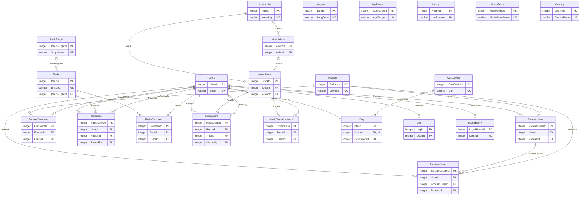

# Structure de la base de données

🇬🇧 [English](<DB Structure.md>) · 🇫🇷 **Français**

> **Fichier généré** par `scripts/gen_db_doc.py` à partir de `app/models.py` — ne pas modifier
> à la main (sauf la section *Notes*). Après un changement de schéma : ajouter l'`ALTER TABLE`
> dans `db/seed.py` (`ensure_schema_upgrades`), puis relancer le script.
> La version anglaise (`DB Structure.md`) est traduite à la main : la mettre à jour aussi.

Base SQLite (`db/tunoova.db`). Les données de référence (Langues, AgeRange, Hobby, MusicGenre,
Country) sont définies dans `db/seed.py`.

## Notes

<!-- NOTES:BEGIN (section libre, conservee a chaque generation) -->
_Aucune note pour l'instant._
<!-- NOTES:END -->

## Tables

- [Users](#users)
- [Langues](#langues)
- [AgeRange](#agerange)
- [Hobby](#hobby)
- [MusicGenre](#musicgenre)
- [Country](#country)
- [Podcast](#podcast)
- [PodcastUsers](#podcastusers)
- [EpisodesUsers](#episodesusers)
- [PodcastComment](#podcastcomment)
- [Radio](#radio)
- [RadioPlugIn](#radioplugin)
- [RadioUsers](#radiousers)
- [RadioComment](#radiocomment)
- [MusicArtist](#musicartist)
- [MusicAlbum](#musicalbum)
- [MusicTrack](#musictrack)
- [MusicUsers](#musicusers)
- [MusicTrackComment](#musictrackcomment)
- [Play](#play)
- [CastDevice](#castdevice)
- [Log](#log)
- [LoginHistory](#loginhistory)

## Relations

## Users

| Colonne | Type | NULL | Défaut | Clés | Description |
|---|---|---|---|---|---|
| **UsersId** | INTEGER | non |  | PK |  |
| Email | VARCHAR(320) | non |  | unique, index |  |
| FullName | VARCHAR(120) | non |  |  |  |
| Password | VARCHAR(60) | non |  |  | hash bcrypt |
| Photo | VARCHAR(255) | oui |  |  |  |
| Langue | VARCHAR(2) | non | `'en'` |  | Langues.LangCode |
| Notifications | BOOLEAN | non | `true` |  |  |
| AgeRange | VARCHAR(50) | oui |  |  | AgeRange.AgeRange, choix unique |
| Hobby | VARCHAR(512) | oui |  |  | multi-choix, stocke separe par virgules |
| MusicGenre | VARCHAR(512) | oui |  |  | multi-choix, stocke separe par virgules |
| Country | VARCHAR(80) | oui |  |  | utilise pour prioriser la recherche Radio (CDC §8) |
| FirstLogin | BOOLEAN | non | `true` |  |  |
| FailedLoginAttempts | INTEGER | non | `0` |  | echecs de connexion consecutifs |
| LockedUntil | DATETIME | oui |  |  | compte verrouille jusqu'a cette date |
| IsActive | BOOLEAN | non | `true` |  |  |
| LastLogin | DATETIME | oui |  |  | ecran Admin - Comptes utilisateurs |
| DarkMode | BOOLEAN | non | `false` |  | Ajouts CDC §8/§12 (ecran Settings) : absents du schema initial, necessaires pour persister ces reglages par utilisateur. |
| YoutubeMusicEnabled | BOOLEAN | non | `false` |  |  |
| StreamQuality | VARCHAR(10) | non | `'auto'` |  | auto; low; high |
| SortPrefs | JSON | oui |  |  | dernier tri par ecran, cf. app/sort_prefs.py |

## Langues

| Colonne | Type | NULL | Défaut | Clés | Description |
|---|---|---|---|---|---|
| **LangId** | INTEGER | non |  | PK |  |
| LangCode | VARCHAR(2) | non |  | unique |  |
| Langue | VARCHAR(50) | non |  |  |  |
| Used | BOOLEAN | non | `false` |  |  |

## AgeRange

| Colonne | Type | NULL | Défaut | Clés | Description |
|---|---|---|---|---|---|
| **AgeRangeId** | INTEGER | non |  | PK |  |
| AgeRange | VARCHAR(30) | non |  | unique |  |
| Description | VARCHAR(120) | oui |  |  |  |
| Used | BOOLEAN | non | `true` |  |  |

## Hobby

| Colonne | Type | NULL | Défaut | Clés | Description |
|---|---|---|---|---|---|
| **HobbyId** | INTEGER | non |  | PK |  |
| HobbyName | VARCHAR(50) | non |  | unique |  |
| Category | VARCHAR(50) | oui |  |  |  |
| Used | BOOLEAN | non | `true` |  |  |

## MusicGenre

| Colonne | Type | NULL | Défaut | Clés | Description |
|---|---|---|---|---|---|
| **MusicGenreId** | INTEGER | non |  | PK |  |
| MusicGenreName | VARCHAR(50) | non |  | unique |  |
| Category | VARCHAR(50) | oui |  |  |  |
| Used | BOOLEAN | non | `true` |  |  |

## Country

| Colonne | Type | NULL | Défaut | Clés | Description |
|---|---|---|---|---|---|
| **CountryId** | INTEGER | non |  | PK |  |
| CountryName | VARCHAR(80) | non |  | unique |  |
| ApiName | VARCHAR(120) | oui |  |  | Valeur exacte attendue par le filtre 'country' de l'API Radio Browser, quand elle differe du nom affiche (ex: "United Kingdom" -> nom complet officiel de l'API). Si vide, CountryName sert aussi de valeur API. |
| Used | BOOLEAN | non | `true` |  |  |

## Podcast

Catalogue partage des podcasts (compteurs globaux).

| Colonne | Type | NULL | Défaut | Clés | Description |
|---|---|---|---|---|---|
| **PodcastId** | INTEGER | non |  | PK |  |
| PodcastName | VARCHAR(512) | non |  |  |  |
| PodcastDescription | VARCHAR(1024) | oui |  |  |  |
| LinkRSS | VARCHAR(2056) | non |  | unique |  |
| LinkImage | VARCHAR(2056) | oui |  |  |  |
| PodcastLike | INTEGER | non | `0` |  |  |
| PodcastNotLike | INTEGER | non | `0` |  |  |
| PodcastComment | INTEGER | non | `0` |  | nombre de PodcastComment |
| PodcastCount | INTEGER | non | `0` |  | nombre d'ecoutes, tous utilisateurs |
| Hobby | VARCHAR(50) | oui |  |  | Hobby.HobbyName, choix unique |
| AgeRange | VARCHAR(50) | oui |  |  | AgeRange.AgeRange, choix unique |

## PodcastUsers

Abonnement + stats propres a un utilisateur pour un podcast.

| Colonne | Type | NULL | Défaut | Clés | Description |
|---|---|---|---|---|---|
| **PodcastUsersId** | INTEGER | non |  | PK |  |
| UsersId | INTEGER | non |  | FK → Users.UsersId, index |  |
| PodcastName | VARCHAR(512) | non |  |  |  |
| LinkRSS | VARCHAR(2056) | non |  |  |  |
| LinkImage | VARCHAR(2056) | oui |  |  |  |
| PodcastId | INTEGER | non |  | FK → Podcast.PodcastId, index |  |
| LastListen | DATETIME | oui |  |  |  |
| CountListen | INTEGER | non | `0` |  |  |
| EpisodeFilter | VARCHAR(256) | oui |  |  | Ajout : absent du schema source, correspond au champ "Filter" de l'ecran EditPodcast (maquette) - syntaxe "max:20 contain:INTEGRALE exclude:LIVE" appliquee lors de la synchro RSS (cf. podcast_service.sync_episodes). |

## EpisodesUsers

| Colonne | Type | NULL | Défaut | Clés | Description |
|---|---|---|---|---|---|
| **EpisodesUsersId** | INTEGER | non |  | PK |  |
| UsersId | INTEGER | non |  | FK → Users.UsersId, index |  |
| PodcastUsersId | INTEGER | non |  | FK → PodcastUsers.PodcastUsersId, index |  |
| PodcastId | INTEGER | non |  | FK → Podcast.PodcastId, index |  |
| EpisodeURL | VARCHAR(2056) | non |  |  |  |
| EpisodeName | VARCHAR(512) | oui |  |  |  |
| EpisodeDescription | VARCHAR(2056) | oui |  |  |  |
| EpisodePublishDate | DATETIME | oui |  |  |  |
| EpisodeStatus | VARCHAR(10) | non | `'New'` |  | New; Unread; Read |
| EpisodeLike | VARCHAR(10) | oui |  |  | Like; Not Like |

## PodcastComment

Commentaires d'un podcast, visibles par tous les utilisateurs qui y sont abonnes (ecran Play, quel que soit l'episode). Plusieurs commentaires possibles par utilisateur ; Podcast.PodcastComment en tient le compte.

| Colonne | Type | NULL | Défaut | Clés | Description |
|---|---|---|---|---|---|
| **CommentId** | INTEGER | non |  | PK |  |
| PodcastId | INTEGER | non |  | FK → Podcast.PodcastId, index |  |
| UsersId | INTEGER | non |  | FK → Users.UsersId, index | auteur |
| CommentText | VARCHAR(2056) | non |  |  |  |
| CreatedAt | DATETIME | non | date/heure courante (UTC) |  |  |

## Radio

Catalogue partage des radios (compteurs globaux).

| Colonne | Type | NULL | Défaut | Clés | Description |
|---|---|---|---|---|---|
| **RadioId** | INTEGER | non |  | PK |  |
| RadioName | VARCHAR(512) | non |  |  |  |
| RadioDescription | VARCHAR(1024) | oui |  |  |  |
| LinkURL | VARCHAR(2056) | non |  | unique |  |
| LinkImage | VARCHAR(2056) | oui |  |  |  |
| RadioLike | INTEGER | non | `0` |  |  |
| RadioNotLike | INTEGER | non | `0` |  |  |
| RadioComment | INTEGER | non | `0` |  | nombre de RadioComment |
| RadioCount | INTEGER | non | `0` |  | nombre d'ecoutes, tous utilisateurs |
| Hobby | VARCHAR(50) | oui |  |  | Hobby.HobbyName, choix unique |
| AgeRange | VARCHAR(50) | oui |  |  | AgeRange.AgeRange, choix unique |
| RadioPlugInId | INTEGER | oui |  | FK → RadioPlugIn.RadioPlugInId | Titre en cours (app/now_playing.py) : plug-in qui sait le recuperer et identifiant de la station chez ce fournisseur (ex. Radio France : 1 = France Inter). PlugInCheckedAt NULL = jamais detecte ; renseigne avec RadioPlugInId NULL = aucun plug-in, seul le repli ICY est essaye. |
| PlugInRef | VARCHAR(100) | oui |  |  |  |
| PlugInCheckedAt | DATETIME | oui |  |  |  |
| PlugInStatus | VARCHAR(10) | oui |  |  | Dernier test du plug-in pour cette radio (bouton Tester de l'Admin) ok ; error |
| PlugInStatusDetail | VARCHAR(1024) | oui |  |  |  |
| PlugInLastTest | DATETIME | oui |  |  |  |

## RadioPlugIn

Plug-ins "titre en cours" (scripts du dossier radio_plugins/), un par fournisseur : la cle d'API sert a toutes les radios qui y sont liees.

| Colonne | Type | NULL | Défaut | Clés | Description |
|---|---|---|---|---|---|
| **RadioPlugInId** | INTEGER | non |  | PK |  |
| PlugInName | VARCHAR(100) | non |  |  |  |
| ScriptName | VARCHAR(100) | non |  | unique |  |
| ApiKey | VARCHAR(512) | oui |  |  |  |
| Version | INTEGER | non | `1` |  | +1 a chaque upload depuis l'Admin |
| Enabled | BOOLEAN | non | `true` |  |  |
| Status | VARCHAR(10) | oui |  |  | ok ; error |
| StatusDetail | VARCHAR(1024) | oui |  |  |  |
| LastCheck | DATETIME | oui |  |  |  |

## RadioUsers

| Colonne | Type | NULL | Défaut | Clés | Description |
|---|---|---|---|---|---|
| **RadioUsersId** | INTEGER | non |  | PK |  |
| UsersId | INTEGER | non |  | FK → Users.UsersId, index |  |
| RadioName | VARCHAR(256) | non |  |  |  |
| LinkURL | VARCHAR(2056) | non |  |  |  |
| LinkImage | VARCHAR(2056) | oui |  |  |  |
| RadiosId | INTEGER | non |  | FK → Radio.RadioId, index |  |
| LastListen | DATETIME | oui |  |  |  |
| CountListen | INTEGER | non | `0` |  |  |
| RadioLike | VARCHAR(10) | oui |  |  | Like; Not Like |
| RadioStatus | VARCHAR(10) | oui |  |  | Shared = partagee par un autre utilisateur, pas encore acceptee (absente de la liste tant qu'il n'a pas appuye sur "Ecouter" dans la notification) ; New = partage d'une radio deja dans sa liste ; Read. |
| SharedBy | INTEGER | oui |  | FK → Users.UsersId | Utilisateur qui a partage cette radio (notification "X vous a partage cette radio") ; NULL = radio ajoutee par l'utilisateur lui-meme. |
| CreatedAt | DATETIME | oui | date/heure courante (UTC) |  | tri des notifications |

## RadioComment

Commentaires d'une radio, visibles par tous les utilisateurs qui l'ont ajoutee (ecran Play). Plusieurs commentaires possibles par utilisateur ; Radio.RadioComment en tient le compte.

| Colonne | Type | NULL | Défaut | Clés | Description |
|---|---|---|---|---|---|
| **CommentId** | INTEGER | non |  | PK |  |
| RadioId | INTEGER | non |  | FK → Radio.RadioId, index |  |
| UsersId | INTEGER | non |  | FK → Users.UsersId, index | auteur |
| CommentText | VARCHAR(2056) | non |  |  |  |
| CreatedAt | DATETIME | non | date/heure courante (UTC) |  |  |

## MusicArtist

Catalogue partage des artistes (CDC §8) - un artiste = une ligne, quelle que soit la source de ses morceaux (MP3 local ou YouTube Music).

| Colonne | Type | NULL | Défaut | Clés | Description |
|---|---|---|---|---|---|
| **ArtistId** | INTEGER | non |  | PK |  |
| Name | VARCHAR(256) | non |  |  |  |
| NameKey | VARCHAR(256) | non |  | unique, index | nom normalise, cf. music_catalog |
| PictureUrl | VARCHAR(2056) | oui |  |  | photo Deezer, cf. cover_service |
| CheckedAt | DATETIME | oui |  |  | derniere recherche de photo (NULL = jamais cherche) |

## MusicAlbum

Catalogue partage des albums. ArtistId = artiste de l'album (tag ID3 'albumartist'), 'Various Artists' pour une compilation - chaque morceau garde son propre interprete dans MusicTrack.ArtistId.

| Colonne | Type | NULL | Défaut | Clés | Description |
|---|---|---|---|---|---|
| **AlbumId** | INTEGER | non |  | PK |  |
| ArtistId | INTEGER | non |  | FK → MusicArtist.ArtistId, index |  |
| Title | VARCHAR(256) | non |  |  |  |
| TitleKey | VARCHAR(256) | non |  |  |  |
| IsCompilation | BOOLEAN | non | `false` |  |  |
| Year | INTEGER | oui |  |  |  |
| CoverUrl | VARCHAR(2056) | oui |  |  | pochette Deezer/iTunes, cf. cover_service |
| CheckedAt | DATETIME | oui |  |  | derniere recherche de pochette (NULL = jamais cherche) |

Unicité : (ArtistId, TitleKey)

## MusicTrack

Catalogue partage des morceaux (compteurs globaux, meme principe que Podcast/Radio). Source 'local' : SourceRef = chemin relatif du MP3 sous MP3_LIBRARY_PATH ; source 'youtube' : SourceRef = videoId YouTube Music.

| Colonne | Type | NULL | Défaut | Clés | Description |
|---|---|---|---|---|---|
| **TrackId** | INTEGER | non |  | PK |  |
| ArtistId | INTEGER | non |  | FK → MusicArtist.ArtistId, index |  |
| AlbumId | INTEGER | oui |  | FK → MusicAlbum.AlbumId, index |  |
| Title | VARCHAR(256) | non |  |  |  |
| TrackNumber | INTEGER | oui |  |  |  |
| Duration | INTEGER | oui |  |  | secondes |
| Source | VARCHAR(10) | non |  |  | local; youtube |
| SourceRef | VARCHAR(2056) | non |  |  |  |
| IsAvailable | BOOLEAN | non | `true` | index | MP3 disparu du disque : masque partout (cf. mp3_library_service.scan_library) plutot que supprime, pour garder l'historique s'il revient ; purge definitive par le job mensuel 'music_purge'. |
| MissingSince | DATETIME | oui |  |  | date de disparition du MP3 (NULL = present) |
| FileMtime | FLOAT | oui |  |  | MP3 local : date de modification / taille du fichier au dernier scan. Si elles changent (tags edites), le scan relit les tags du fichier. |
| FileSize | INTEGER | oui |  |  | octets |
| FromTop | BOOLEAN | non | `false` |  | Morceau YouTube ajoute seulement via "Les plus populaires" d'un artiste : son album n'apparait pas dans la bibliotheque (ecran artiste, tri Album, recherche) tant que l'utilisateur ne l'a pas choisi autrement ("Ecouter", import de l'album) - cf. app/library/routes.py. |
| MusicLike | INTEGER | non | `0` |  | nombre de "J'aime" |
| MusicNotLike | INTEGER | non | `0` |  | nombre de "Je n'aime pas" |
| MusicComment | INTEGER | non | `0` |  | nombre de MusicTrackComment |
| MusicCount | INTEGER | non | `0` |  | nombre d'ecoutes, tous utilisateurs |
| MusicGenre | VARCHAR(50) | oui |  |  | MusicGenre.MusicGenreName, choix unique |
| AgeRange | VARCHAR(50) | oui |  |  | AgeRange.AgeRange, choix unique |
| CreatedAt | DATETIME | non | date/heure courante (UTC) |  |  |

Unicité : (Source, SourceRef)

## MusicUsers

Morceaux lies a un utilisateur (ecoutes, like, commentaire, partage, nouveaute a notifier) - pas tout le catalogue : les ecrans Artiste/Album lisent directement MusicTrack (CDC §8).

| Colonne | Type | NULL | Défaut | Clés | Description |
|---|---|---|---|---|---|
| **MusicUsersId** | INTEGER | non |  | PK |  |
| UsersId | INTEGER | non |  | FK → Users.UsersId, index |  |
| TrackId | INTEGER | non |  | FK → MusicTrack.TrackId, index |  |
| CountListen | INTEGER | non | `0` |  |  |
| MusicStatus | VARCHAR(10) | oui |  |  | New; Unread; Read |
| MusicLike | VARCHAR(10) | oui |  |  | Like; Not Like |
| SharedBy | INTEGER | oui |  | FK → Users.UsersId | Utilisateur qui a partage ce morceau (notification "X vous a partage ce morceau") ; NULL = nouveaute du scan MP3 ou ajout par l'utilisateur. |
| CreatedAt | DATETIME | non | date/heure courante (UTC) |  | Tri des nouveautes par anciennete sur l'ecran Notifications (CDC §8). |

Unicité : (UsersId, TrackId)

## MusicTrackComment

Commentaires d'un morceau, visibles par tous les utilisateurs (ecran Play). Plusieurs commentaires possibles par utilisateur ; MusicTrack.MusicComment en tient le compte.

| Colonne | Type | NULL | Défaut | Clés | Description |
|---|---|---|---|---|---|
| **CommentId** | INTEGER | non |  | PK |  |
| TrackId | INTEGER | non |  | FK → MusicTrack.TrackId, index |  |
| UsersId | INTEGER | non |  | FK → Users.UsersId, index | auteur |
| CommentText | VARCHAR(2056) | non |  |  |  |
| CreatedAt | DATETIME | non | date/heure courante (UTC) |  |  |

## Play

Etat de lecture en cours par utilisateur, pour reprise cross-appareil.

| Colonne | Type | NULL | Défaut | Clés | Description |
|---|---|---|---|---|---|
| **PlayId** | INTEGER | non |  | PK |  |
| UsersId | INTEGER | non |  | FK → Users.UsersId, unique, index |  |
| PlayType | VARCHAR(10) | oui |  |  | Podcast; Radio; Music |
| LinkURL | VARCHAR(2056) | oui |  |  |  |
| PlayStatus | VARCHAR(10) | non | `'Stop'` |  | Play; Pause; Stop |
| ItemId | INTEGER | oui |  |  | Ajouts CDC §2 ("l'etat de lecture (position, contenu en cours, type) reste sauvegarde") : le schema initial ne portait pas de quoi retrouver l'item precis ni la position - nécessaires pour une reprise reelle et pour les actions Like/Comment sur l'ecran Play. EpisodesUsersId / RadioUsersId / TrackId selon PlayType |
| PositionSeconds | FLOAT | non | `0.0` |  |  |
| CastDeviceId | INTEGER | oui |  | FK → CastDevice.CastDeviceId, index | Ajout fonctionnalite Cast : NULL = lecture locale (navigateur), sinon diffusion en cours sur ce device (cf. app/cast_service.py). PositionSeconds est alors alimente par la position remontee par le device plutot que par <audio>.currentTime cote navigateur. |
| MusicQueue | JSON | oui |  |  | File de lecture musique explicite (TrackIds, ex. "Les plus populaires"), cf. play_service.set_music_queue. En base plutot que dans le cookie de session : chaque reponse renvoie ce cookie (REMEMBER_COOKIE_REFRESH_EACH_REQUEST), une requete longue lancee avant (prechargement du suivant) effacait la file. |

## CastDevice

Enceinte/renderer decouvert sur le reseau local pour la fonctionnalite Cast (CDC §7/§8/§10) : Bose SoundTouch (Web API confort + DLNA pour le contenu) et renderers DLNA generiques (DLNA uniquement). Peuple et rafraichi par le job planifie cast_scan (app/scheduler.py), toutes les 5 minutes par defaut.

| Colonne | Type | NULL | Défaut | Clés | Description |
|---|---|---|---|---|---|
| **CastDeviceId** | INTEGER | non |  | PK |  |
| DeviceType | VARCHAR(20) | non |  |  | Soundtouch; Dlna |
| Udn | VARCHAR(255) | non |  | unique, index |  |
| IpAddress | VARCHAR(45) | non |  |  |  |
| Port | INTEGER | oui |  |  |  |
| DescriptionUrl | VARCHAR(512) | oui |  |  | URL de description UPnP (SetAVTransportURI control point) |
| FriendlyName | VARCHAR(255) | non |  |  | nom renvoye par le device |
| Label | VARCHAR(255) | oui |  |  | nom editable par l'utilisateur (ecran Cast), pre-rempli avec FriendlyName |
| LastSeenAt | DATETIME | non | date/heure courante (UTC) |  | "en ligne" derive de ce champ, pas de colonne dediee |

## Log

Journal d'activite : un enregistrement par affichage d'ecran.

| Colonne | Type | NULL | Défaut | Clés | Description |
|---|---|---|---|---|---|
| **LogId** | INTEGER | non |  | PK |  |
| UsersId | INTEGER | non |  | FK → Users.UsersId, index |  |
| Frame | VARCHAR(50) | non |  |  |  |
| LogDate | DATETIME | non | date/heure courante (UTC) |  |  |
| Device | VARCHAR(50) | oui |  |  |  |
| IPaddress | VARCHAR(50) | oui |  |  |  |
| OS | VARCHAR(50) | oui |  |  |  |

## LoginHistory

Journal des tentatives de connexion (reussies, refusees, comptes verrouilles) et des reprises de session via le cookie "remember me" - permet de detecter une activite suspecte (bruteforce, connexion depuis un appareil/IP inhabituel...). Distinct de Log, qui ne trace que les ecrans vus par un utilisateur deja authentifie.

| Colonne | Type | NULL | Défaut | Clés | Description |
|---|---|---|---|---|---|
| **LoginHistoryId** | INTEGER | non |  | PK |  |
| UsersId | INTEGER | oui |  | FK → Users.UsersId, index | null si l'email ne correspond a aucun compte |
| Email | VARCHAR(320) | non |  |  |  |
| EventType | VARCHAR(20) | non |  |  | success; invalid_user; invalid_password; user_locked; ip_locked; cookie_resume; logout; admin_success; admin_invalid; admin_locked; account_request; reset_request; request_blocked |
| EventDate | DATETIME | non | date/heure courante (UTC) | index |  |
| IpAddress | VARCHAR(45) | oui |  |  |  |
| Device | VARCHAR(50) | oui |  |  |  |
| OS | VARCHAR(50) | oui |  |  |  |

