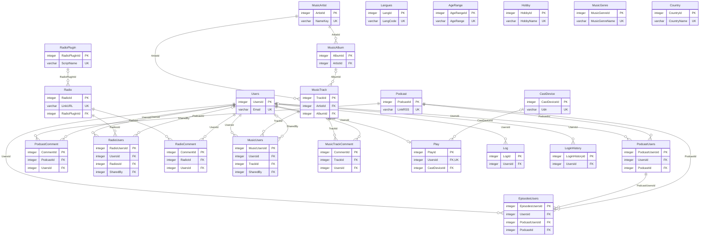

# Database structure

🇬🇧 **English** · 🇫🇷 [Français](<DB Structure.fr.md>)

> **Translated by hand** from `DB Structure.fr.md`, which `scripts/gen_db_doc.py` generates from
> `app/models.py`. After a schema change: add the `ALTER TABLE` in `db/seed.py`
> (`ensure_schema_upgrades`), run the script again, then update this translation.

SQLite database (`db/tunoova.db`). Reference data (Langues, AgeRange, Hobby, MusicGenre,
Country) is defined in `db/seed.py`.

## Notes

_No notes yet._

## Tables

- [Users](#users)
- [Langues](#langues)
- [AgeRange](#agerange)
- [Hobby](#hobby)
- [MusicGenre](#musicgenre)
- [Country](#country)
- [Podcast](#podcast)
- [PodcastUsers](#podcastusers)
- [EpisodesUsers](#episodesusers)
- [PodcastComment](#podcastcomment)
- [Radio](#radio)
- [RadioPlugIn](#radioplugin)
- [RadioUsers](#radiousers)
- [RadioComment](#radiocomment)
- [MusicArtist](#musicartist)
- [MusicAlbum](#musicalbum)
- [MusicTrack](#musictrack)
- [MusicUsers](#musicusers)
- [MusicTrackComment](#musictrackcomment)
- [Play](#play)
- [CastDevice](#castdevice)
- [Log](#log)
- [LoginHistory](#loginhistory)

## Relationships

## Users

| Column | Type | NULL | Default | Keys | Description |
|---|---|---|---|---|---|
| **UsersId** | INTEGER | no |  | PK |  |
| Email | VARCHAR(320) | no |  | unique, index |  |
| FullName | VARCHAR(120) | no |  |  |  |
| Password | VARCHAR(60) | no |  |  | bcrypt hash |
| Photo | VARCHAR(255) | yes |  |  |  |
| Langue | VARCHAR(2) | no | `'en'` |  | Langues.LangCode |
| Notifications | BOOLEAN | no | `true` |  |  |
| AgeRange | VARCHAR(50) | yes |  |  | AgeRange.AgeRange, single choice |
| Hobby | VARCHAR(512) | yes |  |  | multi-choice, stored comma-separated |
| MusicGenre | VARCHAR(512) | yes |  |  | multi-choice, stored comma-separated |
| Country | VARCHAR(80) | yes |  |  | used to prioritize Radio search (spec §8) |
| FirstLogin | BOOLEAN | no | `true` |  |  |
| FailedLoginAttempts | INTEGER | no | `0` |  | consecutive sign-in failures |
| LockedUntil | DATETIME | yes |  |  | account locked until this date |
| IsActive | BOOLEAN | no | `true` |  |  |
| LastLogin | DATETIME | yes |  |  | Admin screen - User accounts |
| DarkMode | BOOLEAN | no | `false` |  | Added for spec §8/§12 (Settings screen): missing from the initial schema, needed to store these settings per user. |
| YoutubeMusicEnabled | BOOLEAN | no | `false` |  |  |
| StreamQuality | VARCHAR(10) | no | `'auto'` |  | auto; low; high |
| SortPrefs | JSON | yes |  |  | last sort per screen, see app/sort_prefs.py |

## Langues

| Column | Type | NULL | Default | Keys | Description |
|---|---|---|---|---|---|
| **LangId** | INTEGER | no |  | PK |  |
| LangCode | VARCHAR(2) | no |  | unique |  |
| Langue | VARCHAR(50) | no |  |  |  |
| Used | BOOLEAN | no | `false` |  |  |

## AgeRange

| Column | Type | NULL | Default | Keys | Description |
|---|---|---|---|---|---|
| **AgeRangeId** | INTEGER | no |  | PK |  |
| AgeRange | VARCHAR(30) | no |  | unique |  |
| Description | VARCHAR(120) | yes |  |  |  |
| Used | BOOLEAN | no | `true` |  |  |

## Hobby

| Column | Type | NULL | Default | Keys | Description |
|---|---|---|---|---|---|
| **HobbyId** | INTEGER | no |  | PK |  |
| HobbyName | VARCHAR(50) | no |  | unique |  |
| Category | VARCHAR(50) | yes |  |  |  |
| Used | BOOLEAN | no | `true` |  |  |

## MusicGenre

| Column | Type | NULL | Default | Keys | Description |
|---|---|---|---|---|---|
| **MusicGenreId** | INTEGER | no |  | PK |  |
| MusicGenreName | VARCHAR(50) | no |  | unique |  |
| Category | VARCHAR(50) | yes |  |  |  |
| Used | BOOLEAN | no | `true` |  |  |

## Country

| Column | Type | NULL | Default | Keys | Description |
|---|---|---|---|---|---|
| **CountryId** | INTEGER | no |  | PK |  |
| CountryName | VARCHAR(80) | no |  | unique |  |
| ApiName | VARCHAR(120) | yes |  |  | Exact value expected by the Radio Browser API 'country' filter, when it differs from the displayed name (e.g. "United Kingdom" -> the API's full official name). If empty, CountryName is also used as the API value. |
| Used | BOOLEAN | no | `true` |  |  |

## Podcast

Shared podcast catalog (global counters).

| Column | Type | NULL | Default | Keys | Description |
|---|---|---|---|---|---|
| **PodcastId** | INTEGER | no |  | PK |  |
| PodcastName | VARCHAR(512) | no |  |  |  |
| PodcastDescription | VARCHAR(1024) | yes |  |  |  |
| LinkRSS | VARCHAR(2056) | no |  | unique |  |
| LinkImage | VARCHAR(2056) | yes |  |  |  |
| PodcastLike | INTEGER | no | `0` |  |  |
| PodcastNotLike | INTEGER | no | `0` |  |  |
| PodcastComment | INTEGER | no | `0` |  | number of PodcastComment rows |
| PodcastCount | INTEGER | no | `0` |  | play count, all users |
| Hobby | VARCHAR(50) | yes |  |  | Hobby.HobbyName, single choice |
| AgeRange | VARCHAR(50) | yes |  |  | AgeRange.AgeRange, single choice |

## PodcastUsers

A user's subscription + own stats for a podcast.

| Column | Type | NULL | Default | Keys | Description |
|---|---|---|---|---|---|
| **PodcastUsersId** | INTEGER | no |  | PK |  |
| UsersId | INTEGER | no |  | FK → Users.UsersId, index |  |
| PodcastName | VARCHAR(512) | no |  |  |  |
| LinkRSS | VARCHAR(2056) | no |  |  |  |
| LinkImage | VARCHAR(2056) | yes |  |  |  |
| PodcastId | INTEGER | no |  | FK → Podcast.PodcastId, index |  |
| LastListen | DATETIME | yes |  |  |  |
| CountListen | INTEGER | no | `0` |  |  |
| EpisodeFilter | VARCHAR(256) | yes |  |  | Added: missing from the source schema, matches the "Filter" field of the EditPodcast screen (mockup) - syntax "max:20 contain:INTEGRALE exclude:LIVE" applied during RSS sync (see podcast_service.sync_episodes). |

## EpisodesUsers

| Column | Type | NULL | Default | Keys | Description |
|---|---|---|---|---|---|
| **EpisodesUsersId** | INTEGER | no |  | PK |  |
| UsersId | INTEGER | no |  | FK → Users.UsersId, index |  |
| PodcastUsersId | INTEGER | no |  | FK → PodcastUsers.PodcastUsersId, index |  |
| PodcastId | INTEGER | no |  | FK → Podcast.PodcastId, index |  |
| EpisodeURL | VARCHAR(2056) | no |  |  |  |
| EpisodeName | VARCHAR(512) | yes |  |  |  |
| EpisodeDescription | VARCHAR(2056) | yes |  |  |  |
| EpisodePublishDate | DATETIME | yes |  |  |  |
| EpisodeStatus | VARCHAR(10) | no | `'New'` |  | New; Unread; Read |
| EpisodeLike | VARCHAR(10) | yes |  |  | Like; Not Like |

## PodcastComment

Comments on a podcast, visible to all users subscribed to it (Play screen, whatever the episode). Several comments allowed per user; Podcast.PodcastComment keeps the count.

| Column | Type | NULL | Default | Keys | Description |
|---|---|---|---|---|---|
| **CommentId** | INTEGER | no |  | PK |  |
| PodcastId | INTEGER | no |  | FK → Podcast.PodcastId, index |  |
| UsersId | INTEGER | no |  | FK → Users.UsersId, index | author |
| CommentText | VARCHAR(2056) | no |  |  |  |
| CreatedAt | DATETIME | no | current date/time (UTC) |  |  |

## Radio

Shared radio catalog (global counters).

| Column | Type | NULL | Default | Keys | Description |
|---|---|---|---|---|---|
| **RadioId** | INTEGER | no |  | PK |  |
| RadioName | VARCHAR(512) | no |  |  |  |
| RadioDescription | VARCHAR(1024) | yes |  |  |  |
| LinkURL | VARCHAR(2056) | no |  | unique |  |
| LinkImage | VARCHAR(2056) | yes |  |  |  |
| RadioLike | INTEGER | no | `0` |  |  |
| RadioNotLike | INTEGER | no | `0` |  |  |
| RadioComment | INTEGER | no | `0` |  | number of RadioComment rows |
| RadioCount | INTEGER | no | `0` |  | play count, all users |
| Hobby | VARCHAR(50) | yes |  |  | Hobby.HobbyName, single choice |
| AgeRange | VARCHAR(50) | yes |  |  | AgeRange.AgeRange, single choice |
| RadioPlugInId | INTEGER | yes |  | FK → RadioPlugIn.RadioPlugInId | Now on air (app/now_playing.py): the plug-in able to fetch it and the station ID at that provider (e.g. Radio France: 1 = France Inter). PlugInCheckedAt NULL = never detected; set with RadioPlugInId NULL = no plug-in, only the ICY fallback is tried. |
| PlugInRef | VARCHAR(100) | yes |  |  |  |
| PlugInCheckedAt | DATETIME | yes |  |  |  |
| PlugInStatus | VARCHAR(10) | yes |  |  | Last plug-in test for this station (Admin Test button) ok; error |
| PlugInStatusDetail | VARCHAR(1024) | yes |  |  |  |
| PlugInLastTest | DATETIME | yes |  |  |  |

## RadioPlugIn

"Now on air" plug-ins (scripts in the radio_plugins/ folder), one per provider: the API key serves all the stations linked to it.

| Column | Type | NULL | Default | Keys | Description |
|---|---|---|---|---|---|
| **RadioPlugInId** | INTEGER | no |  | PK |  |
| PlugInName | VARCHAR(100) | no |  |  |  |
| ScriptName | VARCHAR(100) | no |  | unique |  |
| ApiKey | VARCHAR(512) | yes |  |  |  |
| Version | INTEGER | no | `1` |  | +1 on each upload from the Admin area |
| Enabled | BOOLEAN | no | `true` |  |  |
| Status | VARCHAR(10) | yes |  |  | ok; error |
| StatusDetail | VARCHAR(1024) | yes |  |  |  |
| LastCheck | DATETIME | yes |  |  |  |

## RadioUsers

| Column | Type | NULL | Default | Keys | Description |
|---|---|---|---|---|---|
| **RadioUsersId** | INTEGER | no |  | PK |  |
| UsersId | INTEGER | no |  | FK → Users.UsersId, index |  |
| RadioName | VARCHAR(256) | no |  |  |  |
| LinkURL | VARCHAR(2056) | no |  |  |  |
| LinkImage | VARCHAR(2056) | yes |  |  |  |
| RadiosId | INTEGER | no |  | FK → Radio.RadioId, index |  |
| LastListen | DATETIME | yes |  |  |  |
| CountListen | INTEGER | no | `0` |  |  |
| RadioLike | VARCHAR(10) | yes |  |  | Like; Not Like |
| RadioStatus | VARCHAR(10) | yes |  |  | Shared = shared by another user, not accepted yet (missing from the list until they press "Listen" in the notification); New = share of a station already in their list; Read. |
| SharedBy | INTEGER | yes |  | FK → Users.UsersId | User who shared this station (notification "X shared this station with you"); NULL = station added by the user themselves. |
| CreatedAt | DATETIME | yes | current date/time (UTC) |  | notification sorting |

## RadioComment

Comments on a radio station, visible to all users who added it (Play screen). Several comments allowed per user; Radio.RadioComment keeps the count.

| Column | Type | NULL | Default | Keys | Description |
|---|---|---|---|---|---|
| **CommentId** | INTEGER | no |  | PK |  |
| RadioId | INTEGER | no |  | FK → Radio.RadioId, index |  |
| UsersId | INTEGER | no |  | FK → Users.UsersId, index | author |
| CommentText | VARCHAR(2056) | no |  |  |  |
| CreatedAt | DATETIME | no | current date/time (UTC) |  |  |

## MusicArtist

Shared artist catalog (spec §8) - one artist = one row, whatever the source of their tracks (local MP3 or YouTube Music).

| Column | Type | NULL | Default | Keys | Description |
|---|---|---|---|---|---|
| **ArtistId** | INTEGER | no |  | PK |  |
| Name | VARCHAR(256) | no |  |  |  |
| NameKey | VARCHAR(256) | no |  | unique, index | normalized name, see music_catalog |
| PictureUrl | VARCHAR(2056) | yes |  |  | Deezer photo, see cover_service |
| CheckedAt | DATETIME | yes |  |  | last photo lookup (NULL = never looked up) |

## MusicAlbum

Shared album catalog. ArtistId = the album artist (ID3 tag 'albumartist'), 'Various Artists' for a compilation - each track keeps its own performer in MusicTrack.ArtistId.

| Column | Type | NULL | Default | Keys | Description |
|---|---|---|---|---|---|
| **AlbumId** | INTEGER | no |  | PK |  |
| ArtistId | INTEGER | no |  | FK → MusicArtist.ArtistId, index |  |
| Title | VARCHAR(256) | no |  |  |  |
| TitleKey | VARCHAR(256) | no |  |  |  |
| IsCompilation | BOOLEAN | no | `false` |  |  |
| Year | INTEGER | yes |  |  |  |
| CoverUrl | VARCHAR(2056) | yes |  |  | Deezer/iTunes cover, see cover_service |
| CheckedAt | DATETIME | yes |  |  | last cover lookup (NULL = never looked up) |

Unique: (ArtistId, TitleKey)

## MusicTrack

Shared track catalog (global counters, same principle as Podcast/Radio). Source 'local': SourceRef = relative path of the MP3 under MP3_LIBRARY_PATH; source 'youtube': SourceRef = YouTube Music videoId.

| Column | Type | NULL | Default | Keys | Description |
|---|---|---|---|---|---|
| **TrackId** | INTEGER | no |  | PK |  |
| ArtistId | INTEGER | no |  | FK → MusicArtist.ArtistId, index |  |
| AlbumId | INTEGER | yes |  | FK → MusicAlbum.AlbumId, index |  |
| Title | VARCHAR(256) | no |  |  |  |
| TrackNumber | INTEGER | yes |  |  |  |
| Duration | INTEGER | yes |  |  | seconds |
| Source | VARCHAR(10) | no |  |  | local; youtube |
| SourceRef | VARCHAR(2056) | no |  |  |  |
| IsAvailable | BOOLEAN | no | `true` | index | MP3 gone from the disk: hidden everywhere (see mp3_library_service.scan_library) rather than deleted, to keep its history if it comes back; permanently purged by the monthly 'music_purge' job. |
| MissingSince | DATETIME | yes |  |  | date the MP3 disappeared (NULL = present) |
| FileMtime | FLOAT | yes |  |  | Local MP3: file modification date / size at the last scan. If they change (edited tags), the scan re-reads the file's tags. |
| FileSize | INTEGER | yes |  |  | bytes |
| FromTop | BOOLEAN | no | `false` |  | YouTube track added only through an artist's "Most Popular": its album does not appear in the library (artist screen, Album sort, search) until the user picks it another way ("Listen", album import) - see app/library/routes.py. |
| MusicLike | INTEGER | no | `0` |  | number of "Like" votes |
| MusicNotLike | INTEGER | no | `0` |  | number of "Dislike" votes |
| MusicComment | INTEGER | no | `0` |  | number of MusicTrackComment rows |
| MusicCount | INTEGER | no | `0` |  | play count, all users |
| MusicGenre | VARCHAR(50) | yes |  |  | MusicGenre.MusicGenreName, single choice |
| AgeRange | VARCHAR(50) | yes |  |  | AgeRange.AgeRange, single choice |
| CreatedAt | DATETIME | no | current date/time (UTC) |  |  |

Unique: (Source, SourceRef)

## MusicUsers

Tracks linked to a user (plays, like, comment, share, new item to notify) - not the whole catalog: the Artist/Album screens read MusicTrack directly (spec §8).

| Column | Type | NULL | Default | Keys | Description |
|---|---|---|---|---|---|
| **MusicUsersId** | INTEGER | no |  | PK |  |
| UsersId | INTEGER | no |  | FK → Users.UsersId, index |  |
| TrackId | INTEGER | no |  | FK → MusicTrack.TrackId, index |  |
| CountListen | INTEGER | no | `0` |  |  |
| MusicStatus | VARCHAR(10) | yes |  |  | New; Unread; Read |
| MusicLike | VARCHAR(10) | yes |  |  | Like; Not Like |
| SharedBy | INTEGER | yes |  | FK → Users.UsersId | User who shared this track (notification "X shared this track with you"); NULL = new item from the MP3 scan or added by the user. |
| CreatedAt | DATETIME | no | current date/time (UTC) |  | Sorts new items by age on the Notifications screen (spec §8). |

Unique: (UsersId, TrackId)

## MusicTrackComment

Comments on a track, visible to all users (Play screen). Several comments allowed per user; MusicTrack.MusicComment keeps the count.

| Column | Type | NULL | Default | Keys | Description |
|---|---|---|---|---|---|
| **CommentId** | INTEGER | no |  | PK |  |
| TrackId | INTEGER | no |  | FK → MusicTrack.TrackId, index |  |
| UsersId | INTEGER | no |  | FK → Users.UsersId, index | author |
| CommentText | VARCHAR(2056) | no |  |  |  |
| CreatedAt | DATETIME | no | current date/time (UTC) |  |  |

## Play

Current playback state per user, for cross-device resume.

| Column | Type | NULL | Default | Keys | Description |
|---|---|---|---|---|---|
| **PlayId** | INTEGER | no |  | PK |  |
| UsersId | INTEGER | no |  | FK → Users.UsersId, unique, index |  |
| PlayType | VARCHAR(10) | yes |  |  | Podcast; Radio; Music |
| LinkURL | VARCHAR(2056) | yes |  |  |  |
| PlayStatus | VARCHAR(10) | no | `'Stop'` |  | Play; Pause; Stop |
| ItemId | INTEGER | yes |  |  | Added for spec §2 ("the playback state (position, current content, type) stays saved"): the initial schema could not find the exact item or the position - needed for a real resume and for the Like/Comment actions on the Play screen. EpisodesUsersId / RadioUsersId / TrackId depending on PlayType |
| PositionSeconds | FLOAT | no | `0.0` |  |  |
| CastDeviceId | INTEGER | yes |  | FK → CastDevice.CastDeviceId, index | Added for Cast: NULL = local playback (browser), otherwise currently casting to this device (see app/cast_service.py). PositionSeconds is then fed by the position reported by the device rather than by the browser's <audio>.currentTime. |
| MusicQueue | JSON | yes |  |  | Explicit music queue (TrackIds, e.g. "Most Popular"), see play_service.set_music_queue. Stored in the database rather than in the session cookie: every response sends this cookie back (REMEMBER_COOKIE_REFRESH_EACH_REQUEST), and a long request started earlier (preloading the next track) used to wipe the queue. |

## CastDevice

Speaker/renderer discovered on the local network for Cast (spec §7/§8/§10): Bose SoundTouch (Web API for convenience + DLNA for content) and generic DLNA renderers (DLNA only). Filled and refreshed by the cast_scan scheduled job (app/scheduler.py), every 5 minutes by default.

| Column | Type | NULL | Default | Keys | Description |
|---|---|---|---|---|---|
| **CastDeviceId** | INTEGER | no |  | PK |  |
| DeviceType | VARCHAR(20) | no |  |  | Soundtouch; Dlna |
| Udn | VARCHAR(255) | no |  | unique, index |  |
| IpAddress | VARCHAR(45) | no |  |  |  |
| Port | INTEGER | yes |  |  |  |
| DescriptionUrl | VARCHAR(512) | yes |  |  | UPnP description URL (SetAVTransportURI control point) |
| FriendlyName | VARCHAR(255) | no |  |  | name reported by the device |
| Label | VARCHAR(255) | yes |  |  | name editable by the user (Cast screen), prefilled with FriendlyName |
| LastSeenAt | DATETIME | no | current date/time (UTC) |  | "online" derived from this field, no dedicated column |

## Log

Activity log: one row per screen display.

| Column | Type | NULL | Default | Keys | Description |
|---|---|---|---|---|---|
| **LogId** | INTEGER | no |  | PK |  |
| UsersId | INTEGER | no |  | FK → Users.UsersId, index |  |
| Frame | VARCHAR(50) | no |  |  |  |
| LogDate | DATETIME | no | current date/time (UTC) |  |  |
| Device | VARCHAR(50) | yes |  |  |  |
| IPaddress | VARCHAR(50) | yes |  |  |  |
| OS | VARCHAR(50) | yes |  |  |  |

## LoginHistory

Log of sign-in attempts (successful, rejected, locked accounts) and of session resumes through the "remember me" cookie - helps detect suspicious activity (brute force, sign-in from an unusual device/IP...). Separate from Log, which only records the screens seen by an already authenticated user.

| Column | Type | NULL | Default | Keys | Description |
|---|---|---|---|---|---|
| **LoginHistoryId** | INTEGER | no |  | PK |  |
| UsersId | INTEGER | yes |  | FK → Users.UsersId, index | null if the email matches no account |
| Email | VARCHAR(320) | no |  |  |  |
| EventType | VARCHAR(20) | no |  |  | success; invalid_user; invalid_password; user_locked; ip_locked; cookie_resume; logout; admin_success; admin_invalid; admin_locked; account_request; reset_request; request_blocked |
| EventDate | DATETIME | no | current date/time (UTC) | index |  |
| IpAddress | VARCHAR(45) | yes |  |  |  |
| Device | VARCHAR(50) | yes |  |  |  |
| OS | VARCHAR(50) | yes |  |  |  |

