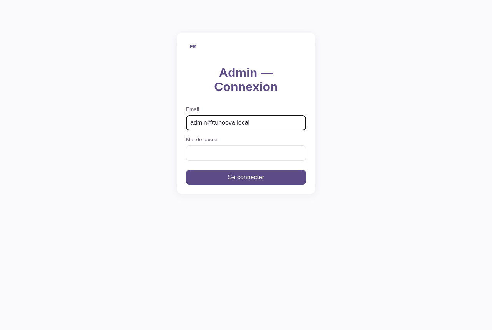
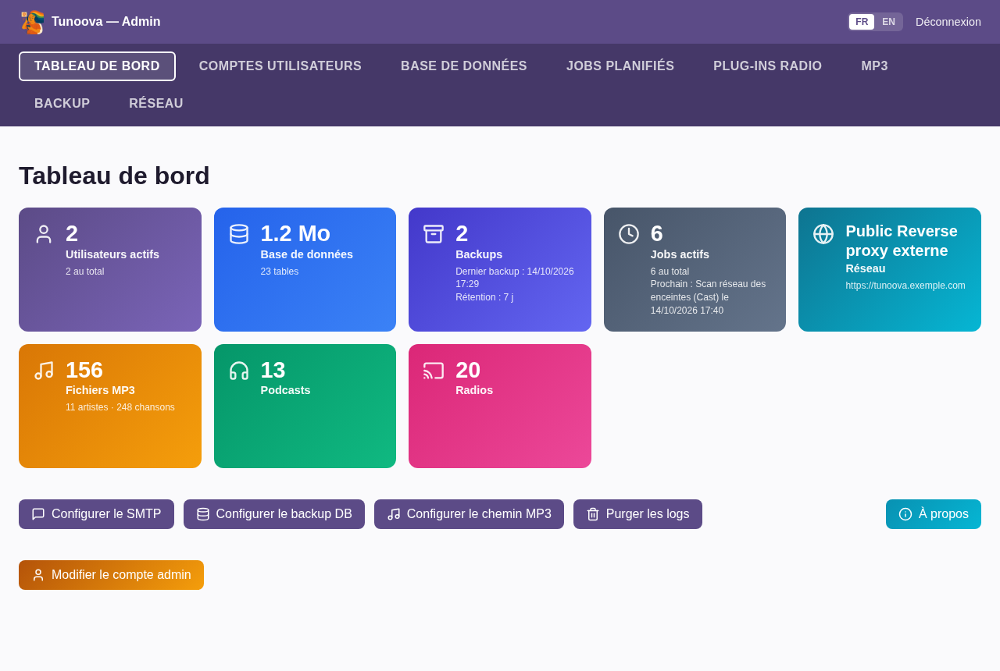
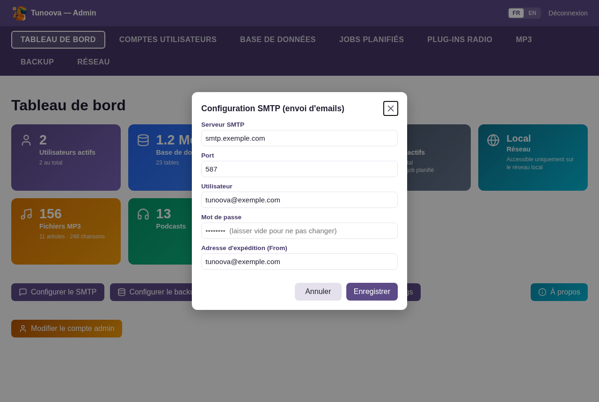
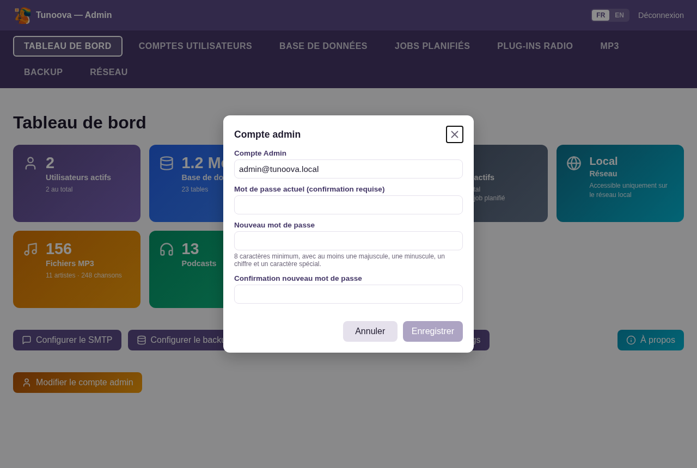
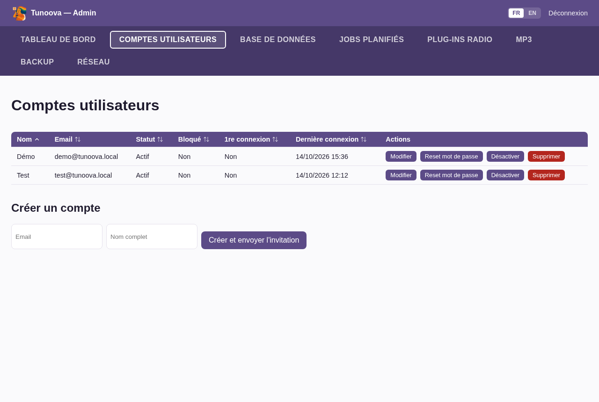
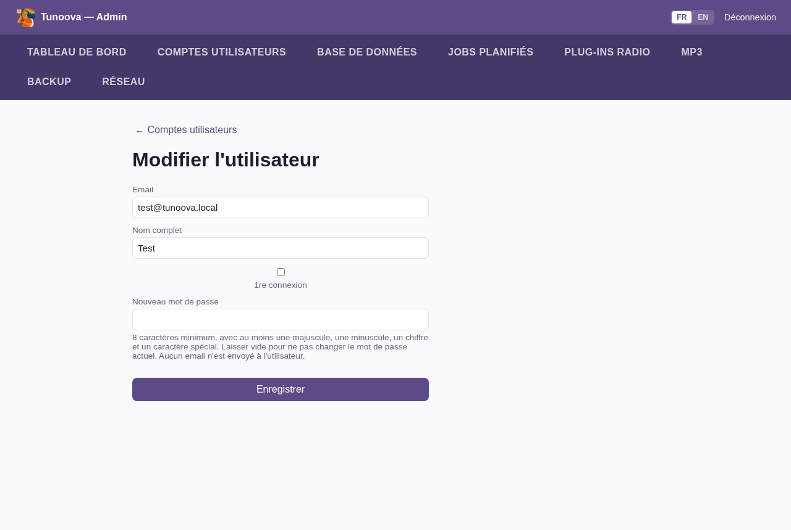
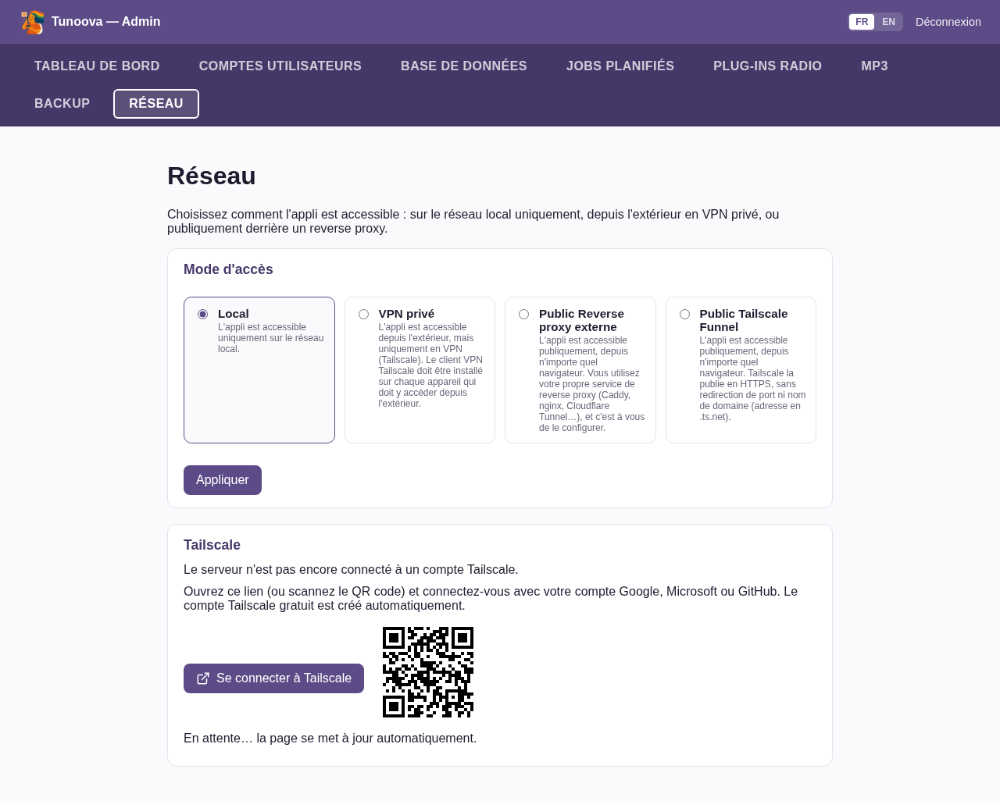
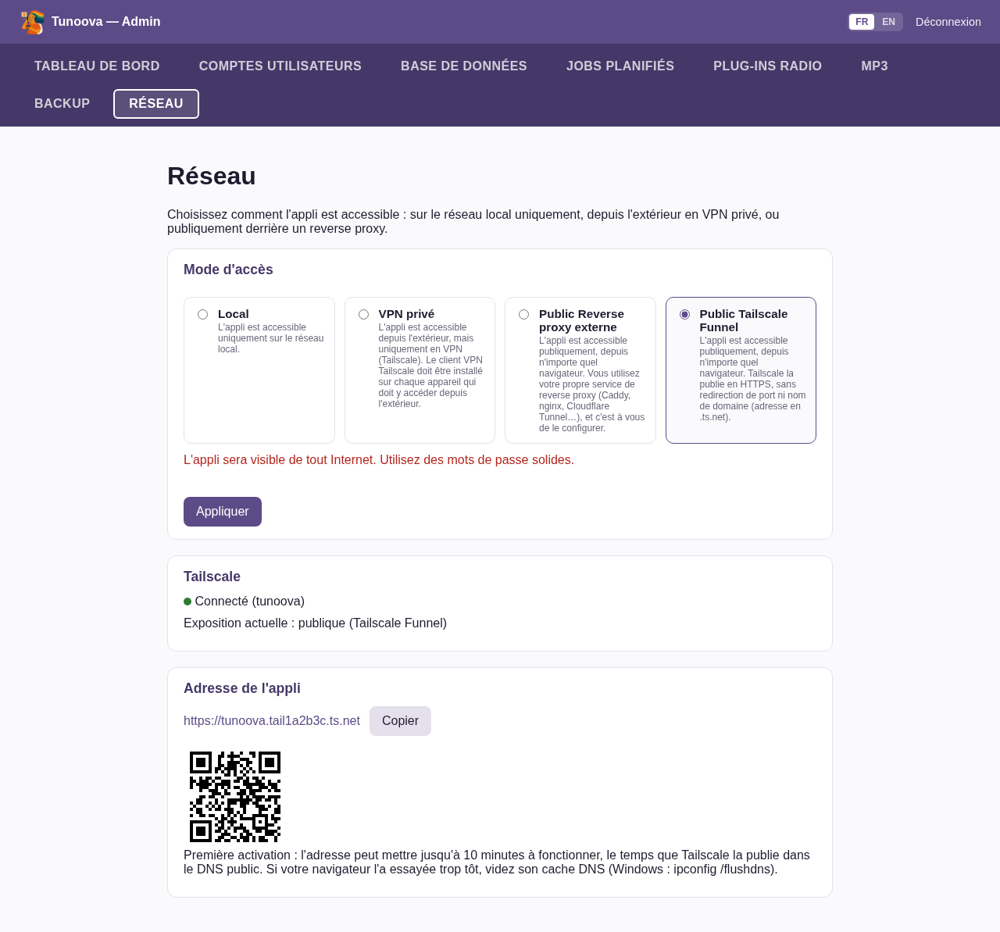
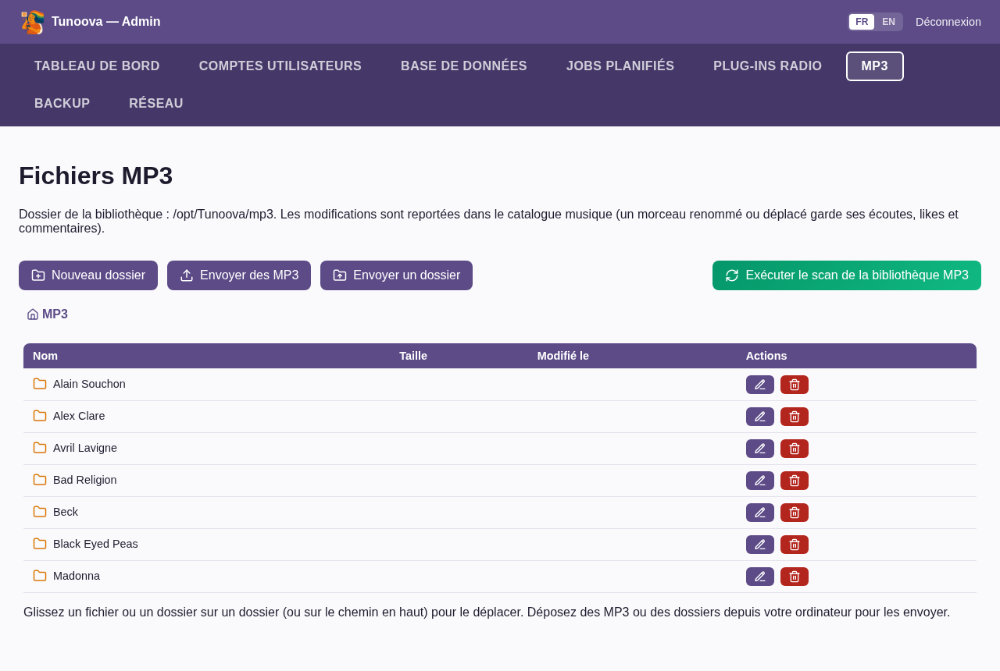

# Installation et mise en route de Tunoova

🇬🇧 [English](Installation.md) · 🇫🇷 **Français**

Ce document explique comment installer Tunoova sur un serveur, le configurer la première fois depuis l'Espace Admin, le mettre à jour, et l'exploiter au quotidien (commandes utiles, dépannage).

Tout passe par le script `install.sh` situé à la racine du dépôt. Il sert à installer, à mettre à jour et à réinitialiser le mot de passe admin.

## Démarrage rapide

1. **Installer** (sur une Debian ou Ubuntu, voir §2) :

   ```bash
   sudo apt update && sudo apt install git
   cd /opt && sudo git clone https://github.com/jlp352/Tunoova.git
   cd Tunoova && sudo ./install.sh
   ```

   Le script demande l'email et le mot de passe admin, puis le port (Entrée = 5000).
2. **Se connecter à l'Espace Admin** : `http://<ip-du-serveur>:5000/admin`, avec le compte admin.
3. **Tableau de bord > Configurer le SMTP**, pour envoyer les invitations. Sans SMTP, voir §3.4.
4. **Comptes utilisateurs** : créer son propre compte. Le compte admin n'ouvre pas l'appli.
5. **MP3** : envoyer sa musique depuis son PC (§3.6).
6. Facultatif : **Réseau**, pour accéder à l'appli depuis l'extérieur avec Tailscale (§3.5).

Les utilisateurs se connectent ensuite sur `http://<ip-du-serveur>:5000/`. Pour une meilleure utilisation, chacun installe l'appli depuis Chrome : icône **Installer** de la barre d'adresse en accès distant (Tailscale ou reverse proxy), sinon menu **⋮ > Caster, enregistrer et partager > Installer la page en tant qu'application** (voir le [README](../README.fr.md#31-obtenir-un-compte-et-se-connecter)). La suite du document détaille chaque étape, les mises à jour et le dépannage.

## 1. Prérequis

- Une machine Linux Debian ou Ubuntu, avec `systemd` : mini-PC, Raspberry Pi, machine virtuelle ou conteneur LXC (Proxmox).
- Un accès root.
- Un accès Internet sortant : paquets système, dépendances Python, YouTube Music, annuaires de podcasts et de radios.
- Facultatif :
  - un compte email avec accès SMTP, pour envoyer les invitations et les liens de réinitialisation ;
  - un compte Tailscale, pour accéder à l'appli depuis l'extérieur (gratuit, voir §3.5).

## 2. Installation

### 2.1 Lancer l'installation

Sur une Debian minimale, `sudo` n'est pas toujours présent. Il s'installe en root :

```bash
su -                      # passer root (Debian minimale sans sudo)
apt install sudo
exit
```

Puis, depuis un compte qui a les droits `sudo` :

```bash
sudo apt update
sudo apt upgrade
sudo apt install git
cd /opt
sudo git clone https://github.com/jlp352/Tunoova.git
cd Tunoova
sudo ./install.sh
```

`install.sh` **ne clone jamais le dépôt lui-même**. Il travaille sur le dossier dans lequel il se trouve, qui doit être un clone git (pas une archive téléchargée). Le dossier recommandé est `/opt/Tunoova`.

Sans argument, le script installe s'il ne trouve pas de service `tunoova` et met à jour sinon. On peut aussi forcer l'action :

```bash
sudo ./install.sh install   # force une première installation
sudo ./install.sh update    # force une mise à jour
sudo ./install.sh reset     # réinitialise le mot de passe admin
```

### 2.2 Ce que fait le script

- Installe les paquets système nécessaires : Python, git, ffmpeg (Cast YouTube Music), deno (lecture YouTube Music).
- Crée le compte système `tunoova`, sous lequel tourne l'appli, ainsi que son environnement Python (`.venv`).
- Crée le fichier de configuration `.env` et la base de données.
- Crée le service `tunoova`, qui démarre l'appli au boot, et prépare le bouton « Mettre à jour » de l'Espace Admin (§4.1).
- Installe le client Tailscale, sans rien exposer tant qu'il n'est pas activé depuis Admin > Réseau (§3.5).

### 2.3 Questions posées pendant l'installation

**Email du compte admin.** Saisir une adresse email valide. Elle sert d'identifiant pour l'Espace Admin et reçoit les demandes de compte et de réinitialisation envoyées depuis l'écran de connexion.

```
Admin account email: admin@exemple.com
```

**Mot de passe admin** (saisi deux fois, masqué). Le script impose au moins 8 caractères, avec une majuscule, une minuscule, un chiffre et un caractère spécial. Si l'appli doit être accessible depuis Internet, choisir un mot de passe d'au moins 12 caractères.

```
Admin password:
Confirm password:
```

**Port d'écoute.** Appuyer sur Entrée pour garder 5000, ou saisir un autre port s'il est déjà pris sur la machine.

```
Application listen port [5000]:
```

**Clé de déploiement (dépôt privé uniquement).** Si le dépôt GitHub est privé, le serveur a besoin d'une clé en lecture seule pour télécharger les mises à jour. Le script la génère et l'affiche :

```
[warning] The GitHub repository jlp352/Tunoova is private. Add this READ-ONLY deploy key to it:
  1. Open https://github.com/jlp352/Tunoova/settings/keys and click 'Add deploy key'
  2. Title: tunoova@<machine> - leave 'Allow write access' UNCHECKED
  3. Key:

ssh-ed25519 AAAA... tunoova@<machine>

Press Enter once the key is added (or type 'skip' to continue without the Update button):
```

Sur GitHub, ouvrir le dépôt, puis **Settings > Deploy keys > Add deploy key**. Coller la ligne `ssh-ed25519 …`, **sans cocher** « Allow write access », puis appuyer sur Entrée dans le terminal. Si on répond `skip`, l'installation continue sans le bouton « Mettre à jour ». On peut le configurer plus tard avec `sudo ./install.sh update`. Si le dépôt est public, cette étape n'apparaît pas.

En fin d'installation, le script affiche l'adresse de l'appli :

```
[ok] Tunoova is up and reachable at: http://192.168.1.50:5000/ -- open http://192.168.1.50:5000/admin to start configuration.
[ok] Installation complete.
```

## 3. Première configuration

### 3.1 Se connecter à l'Espace Admin

Ouvrir `http://<adresse-du-serveur>:5000/admin` et se connecter avec l'email et le mot de passe choisis pendant l'installation.

<p align="center"></p>

> **Compte admin et compte utilisateur sont deux choses différentes.**
>
> - Le **compte admin** (défini dans `.env` par `install.sh`) ouvre **uniquement l'Espace Admin** (`/admin`).
> - Pour écouter de la musique, il faut un **compte utilisateur** : il se crée dans l'onglet Comptes utilisateurs (§3.4), y compris pour soi-même, et on peut y mettre la même adresse email que le compte admin.

L'onglet **Tableau de bord** regroupe les réglages : SMTP, backup, chemin MP3, purge des logs et compte admin.

<p align="center"></p>

### 3.2 Configurer l'envoi d'emails (SMTP)

**Tableau de bord > Configurer le SMTP.** Renseigner :
- le serveur et le port (en général 587, la connexion est chiffrée en STARTTLS) ;
- l'utilisateur et le mot de passe du compte email ;
- l'adresse d'expédition.

<p align="center"></p>

Les emails servent :
- aux invitations envoyées aux nouveaux utilisateurs ;
- aux liens de réinitialisation de mot de passe ;
- aux notifications reçues par l'admin (demande de compte depuis l'écran de connexion).

Avec Gmail, utiliser un **mot de passe d'application** (`smtp.gmail.com`, port 587), pas le mot de passe du compte.

Sans SMTP, l'appli fonctionne quand même, mais aucun email ne part (voir §3.4 pour créer les comptes dans ce cas).

### 3.3 Vérifier le compte admin

**Tableau de bord > Modifier le compte admin** permet de changer l'email ou le mot de passe admin sans repasser par le terminal.

<p align="center"></p>

### 3.4 Créer les comptes utilisateurs

**Onglet Comptes utilisateurs > Créer un compte.** Saisir l'email et le nom complet, puis cliquer sur **Créer et envoyer l'invitation**. L'utilisateur reçoit un lien d'activation. Il choisit son mot de passe, puis remplit son profil à la première connexion (nom, photo, tranche d'âge, pays, centres d'intérêt, genres musicaux, langue).

<p align="center"></p>

**Sans SMTP configuré**, l'invitation ne part pas. Il faut alors forcer un mot de passe :

1. Créer le compte comme ci-dessus.
2. Cliquer sur **Modifier** sur la ligne de l'utilisateur.
3. Saisir un mot de passe dans **Nouveau mot de passe**.
4. Laisser **1re connexion** cochée pour que l'utilisateur remplisse son profil à sa première connexion.
5. Communiquer ce mot de passe à l'utilisateur. Il pourra le changer ensuite dans ses paramètres.

<p align="center"></p>

Les utilisateurs se connectent à `http://<adresse-du-serveur>:5000/`.

### 3.5 Accéder à l'appli depuis l'extérieur (onglet Réseau)

Par défaut, l'appli n'est accessible que sur le réseau local (mode **Local**). L'onglet **Réseau** propose trois autres modes :

| Mode | Pour qui | Ce qu'il faut |
|---|---|---|
| **VPN privé** | Accès depuis l'extérieur réservé à vos appareils | Un compte Tailscale, et l'app Tailscale installée sur chaque téléphone ou PC qui accède à Tunoova depuis l'extérieur. |
| **Public Tailscale Funnel** | Accès depuis n'importe quel navigateur, sans rien installer | Un compte Tailscale. L'adresse sera de la forme `https://<machine>.<tailnet>.ts.net`, sans ouvrir de port sur la box ni acheter de nom de domaine. |
| **Public Reverse proxy externe** | Vous avez déjà votre nom de domaine et un reverse proxy (Caddy, nginx, Cloudflare Tunnel…) | Configurer le proxy vers `http://<serveur>:5000`, puis saisir le nom DNS dans l'onglet. |

**À propos de Tailscale.** Tailscale est un VPN qui relie vos appareils entre eux, sans configuration de la box. La formule personnelle est **gratuite** et suffit largement pour un usage familial. Le compte se crée automatiquement en se connectant avec un compte Google, Microsoft ou GitHub : il n'y a ni formulaire ni carte bancaire.

La première utilisation peut dérouter, voici les étapes :

1. Dans **Réseau**, choisir **VPN privé** ou **Public Tailscale Funnel**, puis cliquer sur **Appliquer**.
2. Le cadre **Tailscale** affiche « Le serveur n'est pas encore connecté à un compte Tailscale ». Cliquer sur **Se connecter à Tailscale** (ou scanner le QR code avec le téléphone), puis se connecter avec Google, Microsoft ou GitHub. Ce n'est pas l'utilisateur qui se connecte : on **ajoute le serveur** à votre réseau Tailscale. Inutile de lancer `tailscale up` dans le terminal.

   <p align="center"></p>

3. La page se met à jour toute seule. En mode **Public Tailscale Funnel**, Tailscale demande la **première fois** d'autoriser Funnel pour ce serveur. La page affiche un bouton **Autoriser sur Tailscale**, qui ouvre le site de Tailscale : y cliquer sur **Enable**.
4. Une fois connecté, la page affiche « Connecté », l'**adresse de l'appli** et un QR code à scanner depuis les téléphones.

   <p align="center"></p>

Points à connaître :
- **Délai de la première adresse Funnel.** Elle peut mettre jusqu'à 10 minutes à fonctionner, le temps que le DNS public se mette à jour. Si le navigateur l'a essayée trop tôt, vider son cache DNS (Windows : `ipconfig /flushdns`).
- **VPN privé.** Installer l'app Tailscale sur le téléphone et se connecter avec **le même compte** que le serveur.
- **Bon réflexe en mode public.** L'appli est visible de tout Internet : utiliser des mots de passe solides (y compris pour l'admin) et désactiver les comptes inutilisés.
- **Changer d'avis.** Revenir en **Local** et cliquer sur **Appliquer** coupe l'exposition.

### 3.6 Ajouter de la musique et vérifier les sauvegardes

**Envoyer sa musique depuis son PC.** L'onglet **MP3** permet de transférer les MP3 stockés sur l'ordinateur vers le serveur, directement depuis le navigateur. Il n'y a besoin ni de clé USB, ni de partage réseau, ni de ligne de commande.

<p align="center"></p>

1. Ouvrir **Admin > MP3**. Pour ranger la musique dans un sous-dossier (par exemple par artiste), l'ouvrir d'abord ou le créer avec **Nouveau dossier**.
2. Envoyer les fichiers de l'une de ces trois façons :
   - **Envoyer des MP3** : sélectionner un ou plusieurs fichiers ;
   - **Envoyer un dossier** : sélectionner un dossier entier, sous-dossiers compris (par exemple tout un répertoire `Musique`). L'arborescence est conservée ;
   - **glisser-déposer** des fichiers ou des dossiers depuis l'explorateur de fichiers sur la liste, ou sur un dossier de la liste pour les y mettre.
3. Une barre de progression suit l'envoi. Rester sur la page jusqu'à la fin, sinon l'envoi s'arrête.
4. À la fin, le catalogue est mis à jour automatiquement : les morceaux apparaissent dans **Musique** pour tous les utilisateurs. Les fichiers qui ne sont pas des MP3 sont ignorés.
5. Facultatif : **Exécuter le scan de la bibliothèque MP3** pour récupérer les pochettes d'albums tout de suite. Sinon, le scan automatique s'en charge.

À savoir :
- **Taille par fichier** : 200 Mo maximum par défaut (`MP3_UPLOAD_MAX_MB` dans `.env`).
- **Organisation et tags** : la même page permet de renommer, déplacer (glisser sur un dossier), supprimer et corriger les tags (titre, artiste, album…), fichier par fichier ou pour tout un dossier. Un morceau renommé ou déplacé garde ses écoutes, likes et commentaires.
- **Autre moyen** : copier les fichiers directement dans le dossier `mp3/` du serveur, puis lancer `sudo chown -R tunoova:tunoova /opt/Tunoova/mp3`. Ils seront pris en compte au prochain scan.
- **Autre dossier** : un autre dossier de bibliothèque (un disque externe, par exemple) se choisit dans **Tableau de bord > Configurer le chemin MP3**.

**Sauvegardes et jobs**

- **Sauvegardes** : une sauvegarde de la base et des photos de profil est faite chaque nuit (job `db_backup`, conservée 7 jours par défaut). Le dossier et la durée se règlent dans **Tableau de bord > Configurer le backup DB**. L'onglet **Backup** permet de créer, télécharger et restaurer une sauvegarde. Pensez à copier régulièrement une sauvegarde **hors du serveur**.
- **Jobs planifiés** : l'onglet **Jobs** montre les tâches automatiques (scan MP3, lecture des flux RSS, sauvegarde, découverte des enceintes Cast, purges). On peut y changer leur fréquence ou les lancer à la main.

## 4. Mise à jour

### 4.1 Depuis l'Espace Admin (recommandé)

Le **Tableau de bord** indique si une nouvelle version existe (bouton **Vérifier**). Le bouton **Mettre à jour** lance la mise à jour.

L'appli est arrêtée quelques minutes : la lecture en cours est coupée pour tous les utilisateurs. La page suit l'avancement, puis se recharge à la fin.

Côté technique :
- le bouton dépose une demande, et un service root séparé (`tunoova-update`) exécute `install.sh update` depuis une copie du dépôt appartenant à root (`/var/lib/tunoova/src`) ;
- l'application elle-même n'a jamais les droits root ;
- le détail est dans `/var/log/tunoova-update.log`.

### 4.2 En ligne de commande

```bash
cd /opt/Tunoova
sudo ./install.sh update
```

Étapes effectuées automatiquement :

1. Arrêt du service.
2. Mise à jour des paquets système et de deno (rattrape une nouvelle dépendance système).
3. **Sauvegarde de la base et des photos de profil** avant toute modification :
   - `db/backups/tunoova_pre_update_AAAAMMJJ_HHMMSS.db` ;
   - `db/backups/tunoova_photos_pre_update_AAAAMMJJ_HHMMSS.zip`, s'il y a des photos.
4. Récupération du nouveau code depuis GitHub.
5. Réinstallation des dépendances Python (`requirements.txt`).
6. **Fusion du `.env`** (§4.4).
7. **Mise à jour de la structure de la base** : tables et colonnes ajoutées automatiquement au démarrage.
8. Réapplication des droits, régénération des services systemd, redémarrage et vérification.

### 4.3 Mise à jour rapide via `git pull`

Pour une mise à jour mineure (aucun changement dans `requirements.txt` ni dans les clés de `.env.example`) :

```bash
sudo -u tunoova git -C /opt/Tunoova pull
sudo systemctl restart tunoova
```

Le redémarrage suffit à appliquer les ajouts de tables, de colonnes et de données de référence.

En revanche, ce raccourci ne fait **ni** :
- la sauvegarde préalable ;
- la réinstallation des dépendances ;
- la fusion du `.env` ;
- la réapplication des droits.

Dans le doute, préférer `sudo ./install.sh update`.

### 4.4 Nouveaux paramètres `.env`

Le `.env` de production n'est **jamais écrasé**. À chaque mise à jour, toute clé présente dans `.env.example` mais absente du `.env` est **ajoutée** avec sa valeur par défaut, et le script en affiche la liste. Les valeurs déjà définies ne sont jamais modifiées. La seule exception est `FLASK_DEBUG`, forcé à `0` car le mode debug ne doit jamais tourner en production.

Si une nouvelle clé doit être renseignée, éditer le `.env` (§6), puis redémarrer le service.

### 4.5 Revenir en arrière après une mise à jour

Avant toute mise à jour, `install.sh update` sauvegarde la base et les photos de profil. Si l'appli ne fonctionne plus après une mise à jour, on peut restaurer cet état :

```bash
sudo systemctl stop tunoova
sudo -u tunoova cp /opt/Tunoova/db/backups/tunoova_pre_update_AAAAMMJJ_HHMMSS.db /opt/Tunoova/db/tunoova.db
sudo -u tunoova unzip -o /opt/Tunoova/db/backups/tunoova_photos_pre_update_AAAAMMJJ_HHMMSS.zip -d /opt/Tunoova/db/profile_photos
sudo systemctl start tunoova
```

La ligne `unzip` ne sert que si une archive de photos a été créée.

Pour revenir aussi à l'ancien code, remplacer `<commit>` par l'identifiant de l'ancienne version :

```bash
sudo -u tunoova git -C /opt/Tunoova reset --hard <commit>
```

La liste des versions s'affiche avec `git -C /opt/Tunoova log --oneline`.

Le fonctionnement des évolutions de la base est décrit dans la [Documentation technique](Documentation%20technique.md#93-évolution-du-schéma).

## 5. Mot de passe admin oublié

```bash
cd /opt/Tunoova
sudo ./install.sh reset
```

Le script demande le nouveau mot de passe deux fois, en saisie masquée. L'email admin reste le même. Le mot de passe est haché, écrit dans `ADMIN_PASSWORD_HASH` (`.env`), puis le service redémarre.

## 6. Commandes utiles

**Service Tunoova**

```bash
sudo systemctl status tunoova                   # état du service
sudo systemctl restart tunoova                  # redémarrer (après modification du .env par exemple)
sudo systemctl stop tunoova                     # arrêter
sudo systemctl start tunoova                    # démarrer
sudo journalctl -u tunoova -n 100 --no-pager    # 100 dernières lignes du journal
sudo journalctl -u tunoova -f                   # suivre le journal en direct
sudo journalctl -u tunoova --since "1 hour ago" # journal de la dernière heure
```

**Configuration**

```bash
sudo -u tunoova nano /opt/Tunoova/.env          # éditer la configuration, puis redémarrer le service
cat /opt/Tunoova/.tunoova_port                  # port d'écoute choisi à l'installation
hostname -I                                     # adresse IP du serveur
```

**Mise à jour**

```bash
cd /opt/Tunoova && sudo ./install.sh update     # mise à jour complète
sudo cat /var/log/tunoova-update.log            # journal de la dernière mise à jour lancée depuis l'admin
cat /var/lib/tunoova/update.status              # état de cette mise à jour (running / success / failed)
git -C /opt/Tunoova log -1 --oneline            # version installée
cat /etc/tunoova/deploy_key.pub                 # clé de déploiement à ajouter sur GitHub (dépôt privé)
```

**Sauvegardes**

```bash
ls -lh /opt/Tunoova/db/backups/                 # sauvegardes existantes
scp <serveur>:/opt/Tunoova/db/backups/tunoova_AAAAMMJJ_HHMMSS.db .   # copier une sauvegarde sur son PC
du -sh /opt/Tunoova/db /opt/Tunoova/mp3         # place occupée par la base et les MP3
df -h /opt                                      # espace disque restant
```

**Tailscale**

```bash
tailscale status                                # machines du réseau Tailscale et état de connexion
tailscale serve status                          # ce qui est exposé (VPN privé ou Funnel)
sudo systemctl restart tailscaled               # redémarrer le client Tailscale
sudo journalctl -u tailscaled -n 30 --no-pager  # journal du client Tailscale
sudo tailscale set --operator=tunoova           # autoriser l'appli à piloter Tailscale
```

## 7. Dépannage

| Symptôme | Que faire |
|---|---|
| Le script s'arrête sur `[error] Failed at line …` | La ligne et la commande en cause sont affichées. Corriger (souvent un problème réseau ou apt), puis relancer le script. |
| `does not look like a clone of the Tunoova repository` | Le script n'est pas lancé depuis le dossier cloné. Faire `cd /opt/Tunoova`, puis relancer. |
| `An installation already exists` | L'appli est déjà installée : utiliser `sudo ./install.sh update`. |
| `The tunoova service did not start` ou `not responding on port …` | Lire le journal : `sudo journalctl -u tunoova -n 50 --no-pager`. Si le port est déjà pris, voir `sudo ss -ltnp \| grep :5000`. |
| Page inaccessible depuis un autre appareil du réseau | Vérifier l'adresse (`hostname -I`) et le port. Vérifier qu'aucun pare-feu ne bloque le port (`sudo ufw status`). |
| Le bouton « Mettre à jour » n'apparaît pas ou échoue | Lire `/var/log/tunoova-update.log`. Si le dépôt est privé, vérifier que la clé de déploiement est bien ajoutée sur GitHub, puis relancer `sudo ./install.sh update`. |
| Admin > Réseau : « Le service Tailscale ne répond pas » | `sudo systemctl start tailscaled`. Sur un conteneur LXC sans `/dev/net/tun`, lancer `sudo ./install.sh update`, qui bascule Tailscale en mode compatible. |
| Admin > Réseau : « Le compte tunoova n'est pas autorisé à piloter Tailscale » | `sudo tailscale set --operator=tunoova` |
| Les utilisateurs ne reçoivent pas les invitations | Vérifier les réglages SMTP (serveur, port, mot de passe d'application) et le dossier spam. En attendant, forcer un mot de passe (§3.4). |
| YouTube Music ne lit plus | YouTube change régulièrement son fonctionnement. Lancer une mise à jour : elle met à jour deno, et yt-dlp si une nouvelle version a été intégrée au dépôt. |
