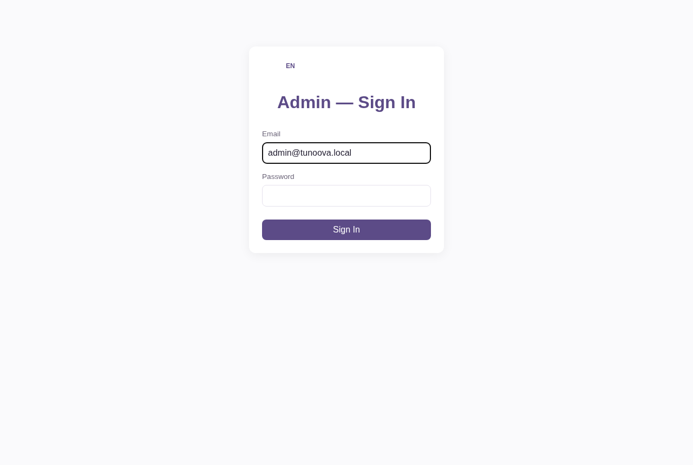
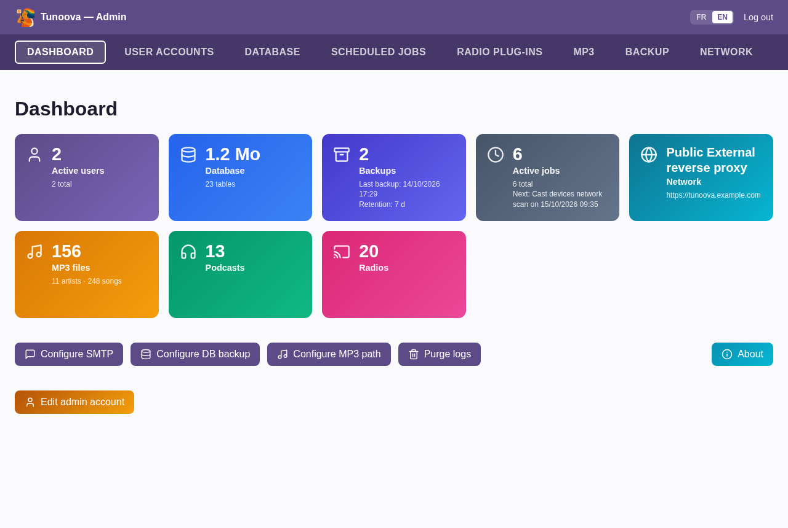
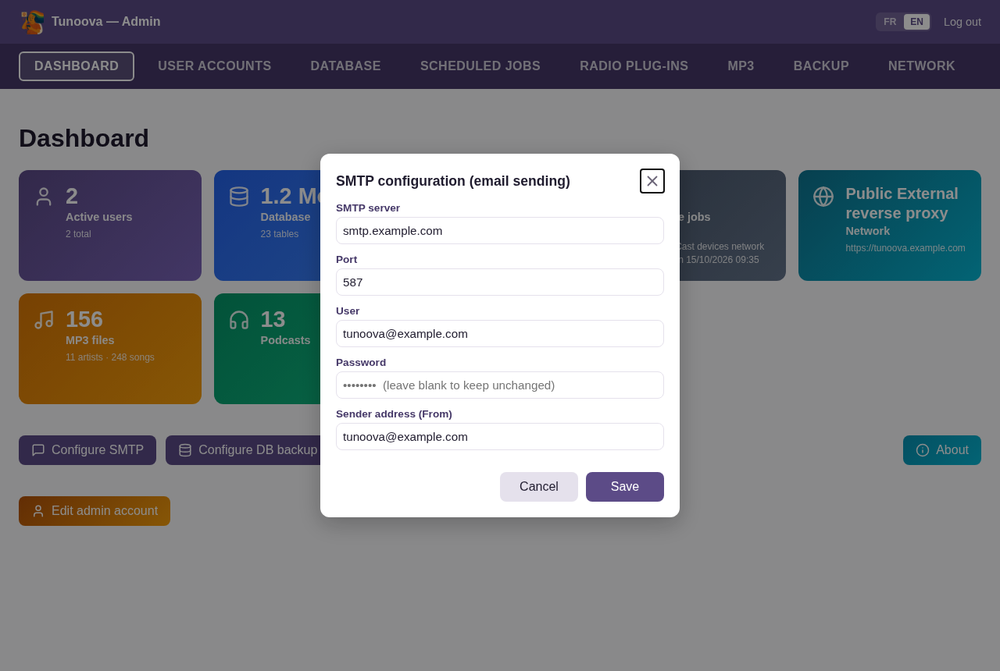
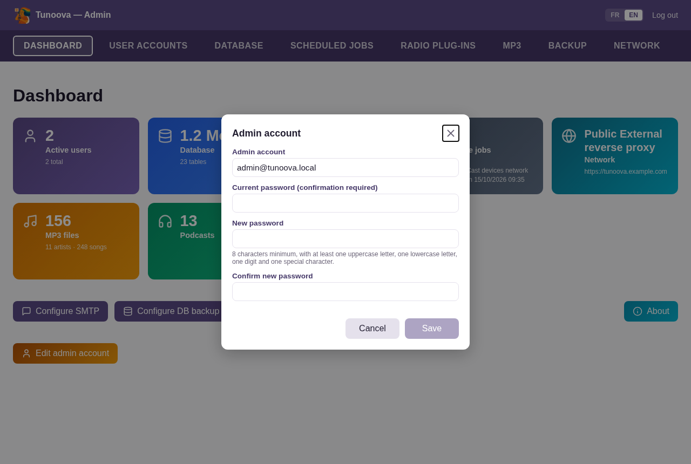
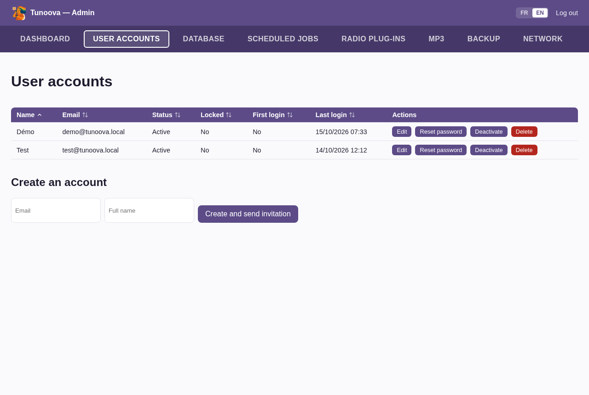
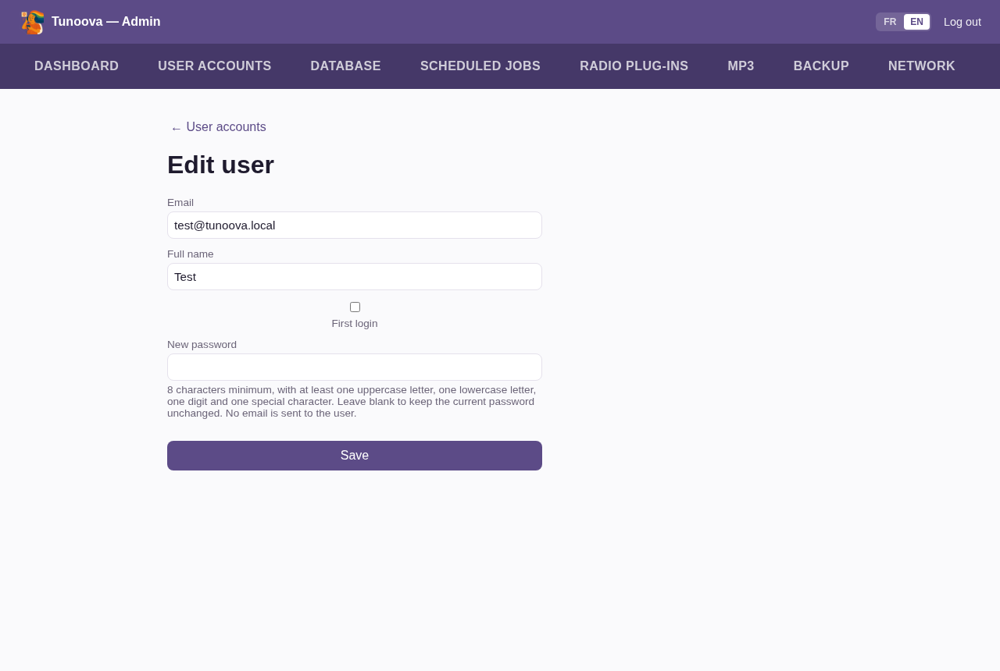
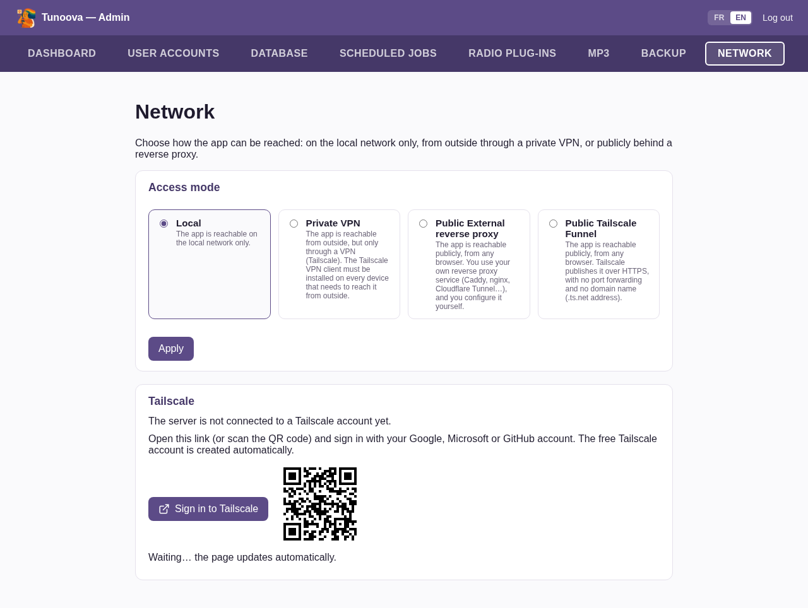
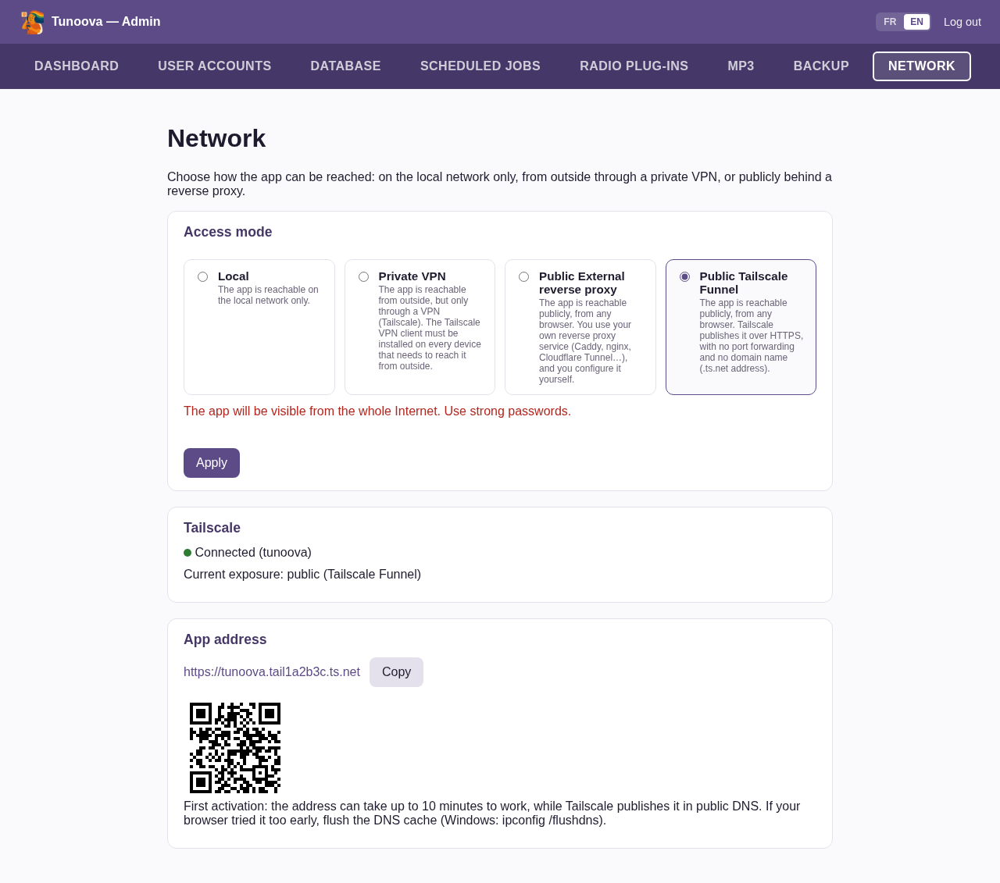
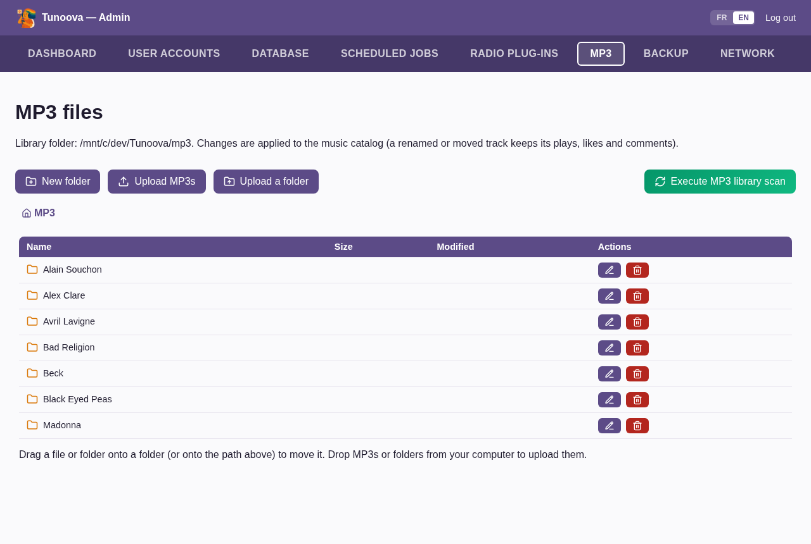

# Installing and setting up Tunoova

🇬🇧 **English** · 🇫🇷 [Français](Installation.fr.md)

This document explains how to install Tunoova on a server, set it up for the first time from the Admin area, update it, and run it day to day (useful commands, troubleshooting).

Everything goes through the `install.sh` script at the root of the repository. It installs, updates and resets the admin password.

## Quick start

1. **Install** (on Debian or Ubuntu, see §2):

   ```bash
   sudo apt update && sudo apt install git
   cd /opt && sudo git clone https://github.com/jlp352/Tunoova.git
   cd Tunoova && sudo ./install.sh
   ```

   The script asks for the admin email and password, then the port (Enter = 5000).
2. **Sign in to the Admin area**: `http://<server-ip>:5000/admin`, with the admin account.
3. **Dashboard > Configure SMTP**, to send invitations. Without SMTP, see §3.4.
4. **User accounts**: create your own account. The admin account does not open the app.
5. **MP3**: upload your music from your PC (§3.6).
6. Optional: **Network**, to reach the app from outside with Tailscale (§3.5).

Users then sign in at `http://<server-ip>:5000/`. For the best experience, everyone installs the app from Chrome: the **Install** icon in the address bar with remote access (Tailscale or reverse proxy), otherwise menu **⋮ > Cast, save, and share > Install page as app** (see the [README](../README.md#31-getting-an-account-and-signing-in)). The rest of this document details each step, updates and troubleshooting.

## 1. Requirements

- A Debian or Ubuntu Linux machine with `systemd`: mini-PC, Raspberry Pi, virtual machine or LXC container (Proxmox).
- Root access.
- Outbound Internet access: system packages, Python dependencies, YouTube Music, podcast and radio directories.
- Optional:
  - an email account with SMTP access, to send invitations and reset links;
  - a Tailscale account, to reach the app from outside (free, see §3.5).

## 2. Installation

### 2.1 Running the installation

On a minimal Debian, `sudo` is not always present. Install it as root:

```bash
su -                      # become root (minimal Debian without sudo)
apt install sudo
exit
```

Then, from an account with `sudo` rights:

```bash
sudo apt update
sudo apt upgrade
sudo apt install git
cd /opt
sudo git clone https://github.com/jlp352/Tunoova.git
cd Tunoova
sudo ./install.sh
```

`install.sh` **never clones the repository itself**. It works on the folder it sits in, which must be a git clone (not a downloaded archive). The recommended folder is `/opt/Tunoova`.

Without an argument, the script installs if it finds no `tunoova` service, and updates otherwise. You can also force the action:

```bash
sudo ./install.sh install   # force a first installation
sudo ./install.sh update    # force an update
sudo ./install.sh reset     # reset the admin password
```

### 2.2 What the script does

- Installs the required system packages: Python, git, ffmpeg (YouTube Music casting), deno (YouTube Music playback).
- Creates the `tunoova` system account the app runs under, and its Python environment (`.venv`).
- Creates the `.env` configuration file and the database.
- Creates the `tunoova` service, which starts the app at boot, and prepares the Admin area's **Update** button (§4.1).
- Installs the Tailscale client, without exposing anything until it is turned on from Admin > Network (§3.5).

### 2.3 Questions asked during installation

**Admin account email.** Enter a valid email address. It is the Admin area login, and it receives the account requests and reset requests sent from the sign-in screen.

```
Admin account email: admin@example.com
```

**Admin password** (typed twice, hidden). The script requires at least 8 characters, with an uppercase letter, a lowercase letter, a digit and a special character. If the app will be reachable from the Internet, choose a password of at least 12 characters.

```
Admin password:
Confirm password:
```

**Listen port.** Press Enter to keep 5000, or type another port if it is already taken on the machine.

```
Application listen port [5000]:
```

**Deploy key (private repository only).** If the GitHub repository is private, the server needs a read-only key to download updates. The script generates and displays it:

```
[warning] The GitHub repository jlp352/Tunoova is private. Add this READ-ONLY deploy key to it:
  1. Open https://github.com/jlp352/Tunoova/settings/keys and click 'Add deploy key'
  2. Title: tunoova@<machine> - leave 'Allow write access' UNCHECKED
  3. Key:

ssh-ed25519 AAAA... tunoova@<machine>

Press Enter once the key is added (or type 'skip' to continue without the Update button):
```

On GitHub, open the repository, then **Settings > Deploy keys > Add deploy key**. Paste the `ssh-ed25519 …` line, **leave** "Allow write access" **unchecked**, then press Enter in the terminal. If you answer `skip`, the installation continues without the **Update** button. You can set it up later with `sudo ./install.sh update`. If the repository is public, this step does not appear.

At the end of the installation, the script shows the app address:

```
[ok] Tunoova is up and reachable at: http://192.168.1.50:5000/ -- open http://192.168.1.50:5000/admin to start configuration.
[ok] Installation complete.
```

## 3. First-time setup

### 3.1 Signing in to the Admin area

Open `http://<server-address>:5000/admin` and sign in with the email and password chosen during installation.

<p align="center"></p>

> **The admin account and user accounts are two different things.**
>
> - The **admin account** (set in `.env` by `install.sh`) opens **only the Admin area** (`/admin`).
> - To listen to music, you need a **user account**: it is created in the User accounts tab (§3.4), including for yourself, and it can use the same email address as the admin account.

The **Dashboard** tab groups the settings: SMTP, backup, MP3 path, log purge and admin account.

<p align="center"></p>

### 3.2 Configuring email (SMTP)

**Dashboard > Configure SMTP.** Fill in:
- the server and port (usually 587, the connection is encrypted with STARTTLS);
- the email account's user and password;
- the sender address.

<p align="center"></p>

Emails are used for:
- invitations sent to new users;
- password reset links;
- notifications to the admin (account requests from the sign-in screen).

With Gmail, use an **app password** (`smtp.gmail.com`, port 587), not the account password.

Without SMTP, the app still works, but no email is sent (see §3.4 to create accounts in that case).

### 3.3 Checking the admin account

**Dashboard > Edit admin account** changes the admin email or password without going back to the terminal.

<p align="center"></p>

### 3.4 Creating user accounts

**User accounts tab > Create an account.** Enter the email and full name, then click **Create and send invitation**. The user receives an activation link. They choose their password, then fill in their profile at first sign-in (name, photo, age range, country, hobbies, music genres, language).

<p align="center"></p>

**Without SMTP configured**, the invitation is not sent. You then have to force a password:

1. Create the account as above.
2. Click **Edit** on the user's row.
3. Type a password in **New password**.
4. Leave **First login** checked so that the user fills in their profile at first sign-in.
5. Give this password to the user. They can change it later in their settings.

<p align="center"></p>

Users sign in at `http://<server-address>:5000/`.

### 3.5 Reaching the app from outside (Network tab)

By default, the app is only reachable on the local network (**Local** mode). The **Network** tab offers three other modes:

| Mode | For whom | What you need |
|---|---|---|
| **Private VPN** | Outside access restricted to your own devices | A Tailscale account, and the Tailscale app installed on every phone or PC that reaches Tunoova from outside. |
| **Public Tailscale Funnel** | Access from any browser, with nothing to install | A Tailscale account. The address looks like `https://<machine>.<tailnet>.ts.net`, with no port to open on the router and no domain name to buy. |
| **Public External reverse proxy** | You already have your own domain name and a reverse proxy (Caddy, nginx, Cloudflare Tunnel…) | Point the proxy to `http://<server>:5000`, then enter the DNS name in the tab. |

**About Tailscale.** Tailscale is a VPN that links your devices together, with no router configuration. The personal plan is **free** and more than enough for family use. The account is created automatically when you sign in with a Google, Microsoft or GitHub account: no form and no credit card.

The first use can be confusing, so here are the steps:

1. In **Network**, choose **Private VPN** or **Public Tailscale Funnel**, then click **Apply**.
2. The **Tailscale** box shows "The server is not connected to a Tailscale account yet." Click **Sign in to Tailscale** (or scan the QR code with your phone), then sign in with Google, Microsoft or GitHub. It is not the user who signs in: you are **adding the server** to your Tailscale network. No need to run `tailscale up` in the terminal.

   <p align="center"></p>

3. The page refreshes by itself. In **Public Tailscale Funnel** mode, Tailscale asks **the first time** to allow Funnel for this server. The page shows an **Allow on Tailscale** button, which opens the Tailscale website: click **Enable** there.
4. Once connected, the page shows "Connected", the **App address** and a QR code to scan from phones.

   <p align="center"></p>

Good to know:
- **Delay for the first Funnel address.** It can take up to 10 minutes to work, while the public DNS updates. If the browser tried it too early, flush its DNS cache (Windows: `ipconfig /flushdns`).
- **Private VPN.** Install the Tailscale app on the phone and sign in with **the same account** as the server.
- **Good habit in public mode.** The app is visible from the whole Internet: use strong passwords (including for the admin) and deactivate unused accounts.
- **Changing your mind.** Going back to **Local** and clicking **Apply** stops the exposure.

### 3.6 Adding music and checking backups

**Upload your music from your PC.** The **MP3** tab transfers the MP3s stored on your computer to the server, straight from the browser. No USB stick, network share or command line needed.

<p align="center"></p>

1. Open **Admin > MP3**. To store the music in a subfolder (for example by artist), open it first or create it with **New folder**.
2. Upload the files in one of three ways:
   - **Upload MP3s**: select one or more files;
   - **Upload a folder**: select a whole folder, subfolders included (for example a whole `Music` directory). The folder tree is kept;
   - **drag and drop** files or folders from your file explorer onto the list, or onto a folder in the list to put them inside it.
3. A progress bar follows the upload. Stay on the page until the end, otherwise the upload stops.
4. At the end, the catalog is updated automatically: the tracks appear in **Music** for all users. Files that are not MP3s are ignored.
5. Optional: **Execute MP3 library scan** to fetch album covers right away. Otherwise, the automatic scan takes care of it.

Good to know:
- **Size per file**: 200 MB maximum by default (`MP3_UPLOAD_MAX_MB` in `.env`).
- **Organization and tags**: the same page lets you rename, move (drag onto a folder), delete and fix tags (title, artist, album…), file by file or for a whole folder. A renamed or moved track keeps its plays, likes and comments.
- **Another way**: copy the files directly into the server's `mp3/` folder, then run `sudo chown -R tunoova:tunoova /opt/Tunoova/mp3`. They will be picked up at the next scan.
- **Another folder**: a different library folder (an external drive, for example) is chosen in **Dashboard > Configure MP3 path**.

**Backups and jobs**

- **Backups**: the database and profile photos are backed up every night (`db_backup` job, kept 7 days by default). The folder and retention are set in **Dashboard > Configure DB backup**. The **Backup** tab lets you create, download and restore a backup. Remember to regularly copy a backup **off the server**.
- **Scheduled jobs**: the **Scheduled jobs** tab shows the automatic tasks (MP3 scan, RSS feed polling, backup, Cast speaker discovery, purges). You can change their frequency or run them by hand.

## 4. Updating

### 4.1 From the Admin area (recommended)

The **Dashboard** shows whether a new version exists (**Check** button). The **Update** button starts the update.

The app is stopped for a few minutes: current playback is cut for all users. The page follows the progress, then reloads at the end.

Under the hood:
- the button drops a request, and a separate root service (`tunoova-update`) runs `install.sh update` from a root-owned copy of the repository (`/var/lib/tunoova/src`);
- the app itself never has root rights;
- the details are in `/var/log/tunoova-update.log`.

### 4.2 From the command line

```bash
cd /opt/Tunoova
sudo ./install.sh update
```

Steps carried out automatically:

1. Stop the service.
2. Update the system packages and deno (catches a new system dependency).
3. **Back up the database and profile photos** before any change:
   - `db/backups/tunoova_pre_update_YYYYMMDD_HHMMSS.db`;
   - `db/backups/tunoova_photos_pre_update_YYYYMMDD_HHMMSS.zip`, if there are photos.
4. Fetch the new code from GitHub.
5. Reinstall the Python dependencies (`requirements.txt`).
6. **Merge `.env`** (§4.4).
7. **Update the database structure**: tables and columns are added automatically at startup.
8. Reapply permissions, regenerate the systemd services, restart and check.

### 4.3 Quick update with `git pull`

For a minor update (no change in `requirements.txt` nor in the `.env.example` keys):

```bash
sudo -u tunoova git -C /opt/Tunoova pull
sudo systemctl restart tunoova
```

The restart is enough to apply new tables, columns and reference data.

However, this shortcut does **not**:
- take the prior backup;
- reinstall the dependencies;
- merge `.env`;
- reapply permissions.

When in doubt, prefer `sudo ./install.sh update`.

### 4.4 New `.env` settings

The production `.env` is **never overwritten**. On each update, any key present in `.env.example` but missing from `.env` is **added** with its default value, and the script lists them. Values already set are never changed. The only exception is `FLASK_DEBUG`, forced to `0` because debug mode must never run in production.

If a new key needs a value, edit `.env` (§6), then restart the service.

### 4.5 Rolling back after an update

Before any update, `install.sh update` backs up the database and profile photos. If the app no longer works after an update, you can restore that state:

```bash
sudo systemctl stop tunoova
sudo -u tunoova cp /opt/Tunoova/db/backups/tunoova_pre_update_YYYYMMDD_HHMMSS.db /opt/Tunoova/db/tunoova.db
sudo -u tunoova unzip -o /opt/Tunoova/db/backups/tunoova_photos_pre_update_YYYYMMDD_HHMMSS.zip -d /opt/Tunoova/db/profile_photos
sudo systemctl start tunoova
```

The `unzip` line is only needed if a photo archive was created.

To also go back to the old code, replace `<commit>` with the identifier of the old version:

```bash
sudo -u tunoova git -C /opt/Tunoova reset --hard <commit>
```

`git -C /opt/Tunoova log --oneline` lists the versions.

How database changes work is described in the [Technical documentation](<Technical documentation.md#93-schema-changes>).

## 5. Forgotten admin password

```bash
cd /opt/Tunoova
sudo ./install.sh reset
```

The script asks for the new password twice, hidden. The admin email stays the same. The password is hashed, written to `ADMIN_PASSWORD_HASH` (`.env`), then the service restarts.

## 6. Useful commands

**Tunoova service**

```bash
sudo systemctl status tunoova                   # service status
sudo systemctl restart tunoova                  # restart (after editing .env, for example)
sudo systemctl stop tunoova                     # stop
sudo systemctl start tunoova                    # start
sudo journalctl -u tunoova -n 100 --no-pager    # last 100 log lines
sudo journalctl -u tunoova -f                   # follow the log live
sudo journalctl -u tunoova --since "1 hour ago" # log of the last hour
```

**Configuration**

```bash
sudo -u tunoova nano /opt/Tunoova/.env          # edit the configuration, then restart the service
cat /opt/Tunoova/.tunoova_port                  # listen port chosen at installation
hostname -I                                     # server IP address
```

**Updates**

```bash
cd /opt/Tunoova && sudo ./install.sh update     # full update
sudo cat /var/log/tunoova-update.log            # log of the last update started from the admin
cat /var/lib/tunoova/update.status              # status of that update (running / success / failed)
git -C /opt/Tunoova log -1 --oneline            # installed version
cat /etc/tunoova/deploy_key.pub                 # deploy key to add on GitHub (private repository)
```

**Backups**

```bash
ls -lh /opt/Tunoova/db/backups/                 # existing backups
scp <server>:/opt/Tunoova/db/backups/tunoova_YYYYMMDD_HHMMSS.db .   # copy a backup to your PC
du -sh /opt/Tunoova/db /opt/Tunoova/mp3         # space used by the database and the MP3s
df -h /opt                                      # free disk space
```

**Tailscale**

```bash
tailscale status                                # machines on the Tailscale network and connection state
tailscale serve status                          # what is exposed (Private VPN or Funnel)
sudo systemctl restart tailscaled               # restart the Tailscale client
sudo journalctl -u tailscaled -n 30 --no-pager  # Tailscale client log
sudo tailscale set --operator=tunoova           # allow the app to control Tailscale
```

## 7. Troubleshooting

| Symptom | What to do |
|---|---|
| The script stops on `[error] Failed at line …` | The line and the failing command are shown. Fix it (often a network or apt problem), then run the script again. |
| `does not look like a clone of the Tunoova repository` | The script is not run from the cloned folder. Run `cd /opt/Tunoova`, then try again. |
| `An installation already exists` | The app is already installed: use `sudo ./install.sh update`. |
| `The tunoova service did not start` or `not responding on port …` | Read the log: `sudo journalctl -u tunoova -n 50 --no-pager`. If the port is already taken, check `sudo ss -ltnp \| grep :5000`. |
| Page unreachable from another device on the network | Check the address (`hostname -I`) and the port. Check that no firewall blocks the port (`sudo ufw status`). |
| The **Update** button does not appear or fails | Read `/var/log/tunoova-update.log`. If the repository is private, check that the deploy key was added on GitHub, then run `sudo ./install.sh update` again. |
| Admin > Network: "The Tailscale service is not responding" | `sudo systemctl start tailscaled`. On an LXC container without `/dev/net/tun`, run `sudo ./install.sh update`, which switches Tailscale to a compatible mode. |
| Admin > Network: "The tunoova account is not allowed to control Tailscale" | `sudo tailscale set --operator=tunoova` |
| Users do not receive invitations | Check the SMTP settings (server, port, app password) and the spam folder. Meanwhile, force a password (§3.4). |
| YouTube Music no longer plays | YouTube regularly changes how it works. Run an update: it updates deno, and yt-dlp if a new version was added to the repository. |
