# Tunoova

🇬🇧 [English](README.md) · 🇫🇷 **Français**

> ### 🚀 [Installer Tunoova →](Doc/Installation.fr.md)
> Installation en une commande sur Debian / Ubuntu / Raspberry Pi OS, première configuration et démarrage rapide.

| Documentation | Contenu |
| --- | --- |
| **[Installation](Doc/Installation.fr.md)** | Installer, configurer la première fois, mettre à jour, commandes utiles |
| [Documentation technique](<Doc/Documentation technique.md>) | Architecture, configuration `.env`, base de données, sécurité |
| [Structure de la base](<Doc/DB Structure.fr.md>) | Détail des tables et colonnes |
| [Plug-ins radio](<Doc/Plugins radio/README.md>) | Écrire un plug-in de radio |
| [Audit de sécurité](<Doc/Audit Tunoova.md>) | Lancer un audit et traiter ses résultats |
| [Licence](Doc/Licence/LICENSE.md) | PolyForm Noncommercial 1.0.0 |

Ce document présente l'application écran par écran, du point de vue utilisateur.

## 1. Qu'est-ce que Tunoova ?

Tunoova (*Tune* + *nova*) est une application web auto-hébergée qui réunit au même endroit :

- vos **podcasts** (abonnements à des flux RSS) ;
- vos **radios** en direct ;
- votre **musique** : les MP3 stockés sur le serveur et, si vous l'activez, YouTube Music.

Elle s'installe sur un Raspberry Pi, un PC du réseau domestique ou un VPS. Elle s'utilise depuis un navigateur, sur ordinateur comme sur téléphone ; son interface est conçue d'abord pour le format mobile. Elle est pensée pour une famille ou un petit groupe d'amis : chaque personne a son compte, ses abonnements et ses préférences, et peut partager ce qu'elle écoute avec les autres.

Ce que l'appli apporte :

- **Un seul lecteur** pour tout ce que vous écoutez. La lecture continue pendant que vous naviguez dans l'appli.
- **La reprise sur un autre appareil** : la lecture en cours est enregistrée sur le serveur. Vous la retrouvez au même endroit sur votre téléphone ou votre ordinateur.
- **Pas de publicité ni de suggestions commerciales.** Rien n'est envoyé à un service tiers pour vous profiler.
- **Votre bibliothèque MP3 accessible partout**, avec pochettes et photos d'artistes trouvées automatiquement.
- **La diffusion sur vos enceintes** du réseau local (Bose SoundTouch, enceintes DLNA).
- **Le partage** entre utilisateurs : partager un morceau, une radio ou un épisode, aimer, commenter.

## 2. Les rôles

| Rôle               | Qui                                | Accès                                                                                                                                             |
| ------------------ | ---------------------------------- | ------------------------------------------------------------------------------------------------------------------------------------------------- |
| **Utilisateur**    | Membre de la famille ou ami invité | L'application : `/`                                                                                                                               |
| **Administrateur** | La personne qui héberge l'appli    | L'Espace Admin : `/admin`. Son compte est distinct des comptes utilisateurs : pour écouter, l'administrateur se crée aussi un compte utilisateur. |

L'inscription est **fermée**. Un visiteur ne peut que **demander** un compte ; c'est l'administrateur qui le crée.

## 3. Parcours de l'utilisateur

### 3.1 Obtenir un compte et se connecter

1. Sur l'écran de connexion, le visiteur clique sur **Créer un compte** et saisit son nom et son email. L'administrateur reçoit la demande par email.
2. L'administrateur crée le compte depuis l'Espace Admin. L'utilisateur reçoit un email avec un **lien d'activation valable 24 heures**, qui lui permet de choisir son mot de passe.
3. L'utilisateur se connecte avec son email et son mot de passe. L'appli garde sa session en mémoire sur cet appareil pendant 30 jours (prolongés à chaque visite) : il n'a pas à retaper son mot de passe.
4. À la **première connexion**, l'écran **Votre profil** lui demande : nom, photo, tranche d'âge, pays, centres d'intérêt, genres musicaux et langue (français ou anglais).
5. Une fois ce profil validé, l'utilisateur trouve déjà dans ses listes un **pack de bienvenue** de quelques radios et podcasts, choisis selon sa langue : France Inter, franceinfo, FIP, RTL, Nostalgie et trois podcasts français pour un francophone, BBC World Service, Classic FM, KEXP, Jazz24, Radio Paradise et trois podcasts anglais pour un anglophone. Il peut les supprimer comme n'importe quel élément ; le pack n'est proposé qu'une seule fois. L'administrateur modifie ces listes dans `app/starter_content.json`.

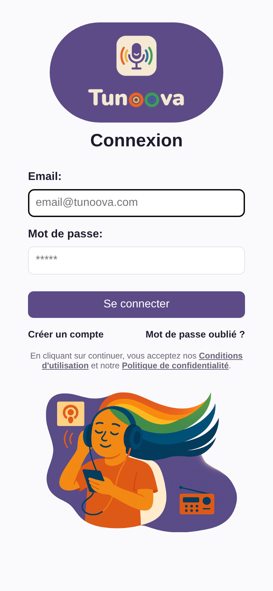

**Mot de passe oublié** : le lien sur l'écran de connexion envoie une demande à l'administrateur, qui déclenche l'envoi d'un lien de réinitialisation (valable 1 heure, utilisable une seule fois).

**Règle de mot de passe** : 8 caractères minimum, avec au moins une majuscule, une minuscule, un chiffre et un caractère spécial.

**Protection** : après 5 échecs de connexion, le compte est bloqué 15 minutes, pour empêcher les attaques par force brute. Les tentatives sont aussi comptées par adresse IP.

Les **Conditions d'utilisation** et la **Politique de confidentialité** sont accessibles depuis l'écran de connexion. L'appli elle-même est distribuée sous licence PolyForm Noncommercial 1.0.0 (usage non commercial uniquement).

**Installer l'appli sur l'appareil (recommandé)** : pour une meilleure utilisation, installez Tunoova depuis **Chrome** comme une application. Elle s'ouvre alors dans sa propre fenêtre, sans barre d'adresse ni onglets, avec son icône dans le menu Démarrer, le Dock ou l'écran d'accueil.

- **Ordinateur (Chrome)** : quand l'appli est ouverte par son adresse `https://` (accès distant Tailscale ou reverse proxy, voir Espace Admin > Réseau), cliquez sur l'icône **Installer** à droite de la barre d'adresse. Sinon, par exemple en `http://<ip>:5000` sur le réseau local : menu **⋮ > Caster, enregistrer et partager > Installer la page en tant qu'application…**, puis **Installer**.
- **Android (Chrome)** : menu **⋮ > Ajouter à l'écran d'accueil**, puis **Installer**.
- **iPhone / iPad (Safari)** : bouton **Partager > Sur l'écran d'accueil**.

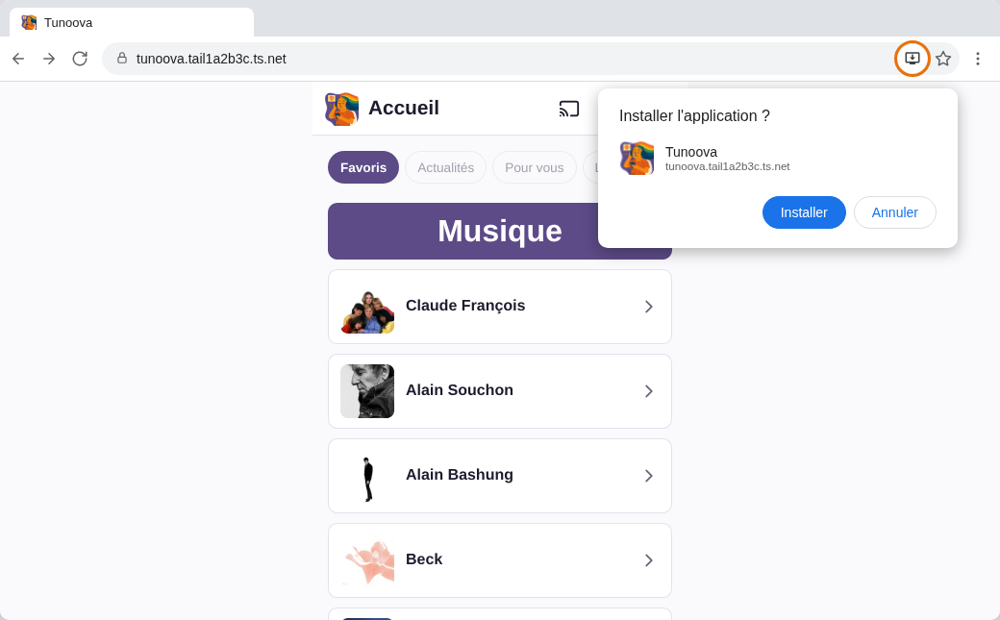

### 3.2 L'interface

Chaque écran comporte :

- **en haut** : le bouton Retour, le bouton **Diffuser** (Cast), la photo de profil (accès au profil) et la déconnexion ;
- **en bas** : le **mini-lecteur** (ce qui joue en ce moment, bouton lecture/pause) et la barre de navigation : Accueil · Podcast · Radio · Musique · Notifications · Paramètres. Un badge sur Notifications indique le nombre de nouveautés.

Un clic sur le mini-lecteur ouvre l'écran **Lecture en cours**.

> Les captures de ce document ont été faites avec un compte de démonstration, au format téléphone.

### 3.3 Accueil

L'Accueil (onglet **Favoris**) affiche vos contenus les plus écoutés :

| Section | Contenu |
|---|---|
| Podcasts | Vos 5 podcasts les plus écoutés |
| Radios | Vos 5 radios les plus écoutées |
| Musique | Les artistes de vos 10 morceaux les plus écoutés (une tuile par artiste) |

Le bouton **Ordre** permet de choisir l'ordre des trois sections (par exemple, mettre la Musique en premier). Ce choix est mémorisé.

Les onglets *Actualités*, *Pour vous* et *Loisirs* sont visibles mais pas encore actifs.

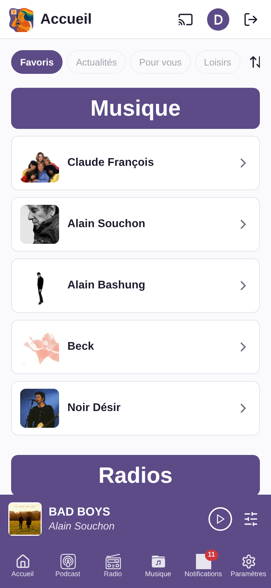

### 3.4 Podcasts

- **Liste** : vos podcasts en tuiles, triables (plus récent, plus ancien, A→Z, Z→A). Le tri choisi est mémorisé.
- **Rechercher** : dès 3 caractères, l'appli cherche à la fois **dans vos podcasts** (nom du podcast ou titre d'un épisode) et **sur Internet** (catalogue Apple Podcasts). Un clic sur **Ajouter** abonne au podcast trouvé.
- **Avancé** : ajout manuel d'un podcast avec son titre, l'URL du flux RSS et l'URL d'une image.
- **Détail d'un podcast** : la liste des épisodes (20 par page, les suivants se chargent en faisant défiler), un bouton pour **actualiser** les épisodes, un bouton **Modifier**.
- **Modifier** : titre, flux RSS, image et **Filtre** des épisodes :
  - `max:20` n'affiche que les 20 premiers épisodes ;
  - `contain:INTEGRALE` ne garde que les titres qui contiennent INTEGRALE ;
  - `exclude:LIVE` retire les titres qui contiennent LIVE.
  
  Le bouton **Supprimer** retire le podcast de votre liste (après confirmation).
- Les **nouveaux épisodes** sont récupérés automatiquement toutes les 30 minutes et apparaissent dans les Notifications. Les épisodes déjà présents quand vous ajoutez un podcast ne sont pas signalés comme nouveaux.
- Les séries en plusieurs parties (« [1/2] », « [2/2] ») sont affichées et enchaînées dans l'ordre de lecture.

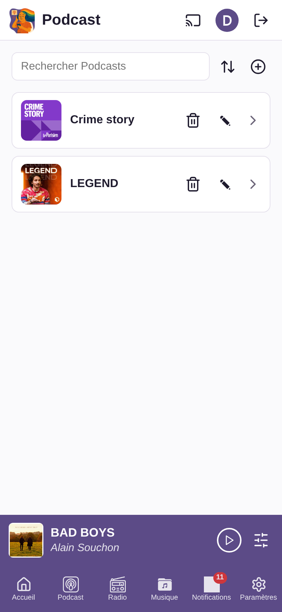 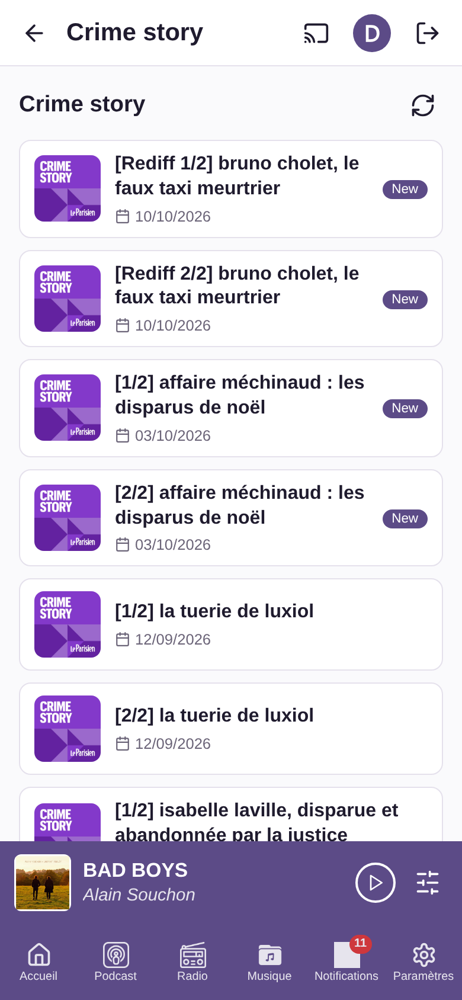

### 3.5 Radios

- **Liste** : vos radios favorites, triables (écoutée récemment, A→Z, Z→A).
- **Rechercher** : dès 3 caractères, l'appli cherche dans vos radios et dans l'annuaire mondial **Radio Browser**. Les radios du pays de votre profil sont proposées en premier. Un clic sur un résultat **ajoute la radio à vos favoris et lance la lecture**.
- **Avancé** : ajout manuel (titre, URL du flux, URL de l'image).
- **Modifier / Supprimer** une radio de votre liste.
- **Titre en cours** : pendant l'écoute, l'appli affiche l'émission ou le morceau diffusé quand c'est possible. Cette information vient de plug-ins (Radio France, groupe RTL, RMC, groupe NRJ, radios belges sont fournis) ; l'administrateur peut en ajouter pour d'autres radios. Sans plug-in, l'appli affiche le titre envoyé par le flux lui-même quand il existe.

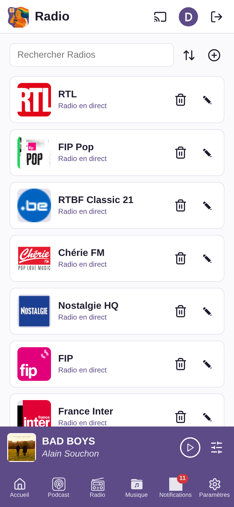

### 3.6 Musique

L'écran Musique présente la bibliothèque partagée par tous les utilisateurs : les MP3 du serveur et les morceaux YouTube Music que les utilisateurs ont ajoutés.

Pour profiter de toutes les fonctionnalités Musique (recherche YouTube, « Les plus populaires », « Autres albums »), activez l'option YouTube Music dans les Paramètres. Vous devez alors respecter les conditions d'utilisation de YouTube Music.

- **Tris** : par **Artiste**, par **Album**, ou **Ma musique préférée** (uniquement ce que vous avez déjà écouté), chacun de A→Z ou Z→A. Le tri est mémorisé.
- **Navigation** : Artiste → ses albums → les morceaux d'un album. Un clic sur un album ou un artiste peut lancer directement la lecture.
- **Les plus populaires** : pour un artiste, ses morceaux les plus écoutés sur YouTube Music.
- **Autres albums** : les albums de l'artiste disponibles sur YouTube Music et absents de la bibliothèque. Ils peuvent être importés.
- **Rechercher** : dès 3 caractères, l'appli cherche dans les MP3 du serveur (titre, artiste, album), puis sur YouTube Music si vous l'avez activé. Elle affiche directement le niveau le plus précis : l'album si la recherche vise un album, l'artiste si elle vise un artiste.
- Les morceaux venant de YouTube Music portent une pastille YouTube.

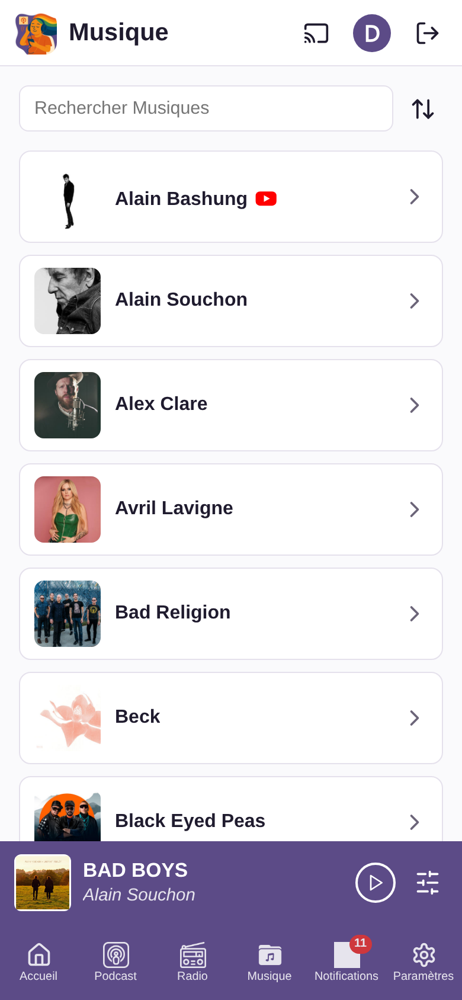 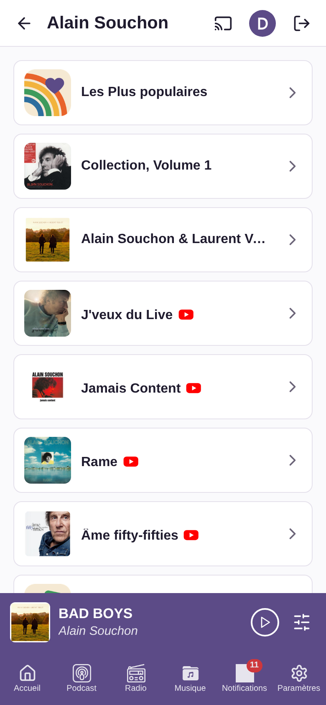 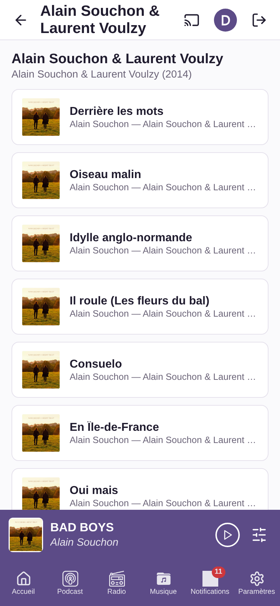

### 3.7 Lecture en cours

L'écran Lecture en cours affiche la grande image du contenu, son titre et :

- la barre de progression (avance/recul), les boutons **Précédent / Lecture-Pause / Suivant** (sauf pour une radio en direct) ;
- **J'aime / Je n'aime pas**, avec le nombre total de votes de tous les utilisateurs ;
- le **nombre d'écoutes** (tous utilisateurs) ;
- les **Commentaires** : un fil partagé par morceau, par radio ou par podcast. Chacun peut publier plusieurs commentaires et supprimer les siens ;
- **Partager** : envoi à un ou plusieurs autres utilisateurs, qui le reçoivent dans leurs Notifications.

Comportements de lecture :

- La lecture **ne s'interrompt pas** quand on change d'écran.
- À la fin d'un morceau ou d'un épisode, le **suivant s'enchaîne** (ordre de l'album, de l'artiste ou de la liste « Les plus populaires »). Sur téléphone, le morceau suivant est téléchargé à l'avance pour que l'enchaînement fonctionne aussi écran verrouillé.
- Les commandes de lecture apparaissent sur l'**écran de verrouillage** du téléphone.
- En revenant dans l'appli, ou sur un autre appareil, la lecture reprend là où elle s'était arrêtée.

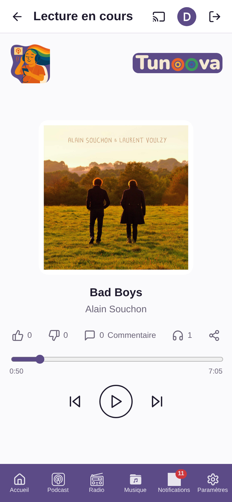

### 3.8 Diffuser sur une enceinte (Cast)

Le bouton **Diffuser** liste les enceintes trouvées sur le réseau local (Bose SoundTouch et appareils DLNA), avec leur état (en ligne, en cours).

- Choisir une enceinte y envoie le contenu en cours, **à la même position**.
- On peut passer d'une enceinte à une autre, régler le **volume** de l'enceinte, mettre en pause, ou arrêter la diffusion pour revenir à la lecture sur l'appareil.
- L'enchaînement des morceaux continue sur l'enceinte.
- Les enceintes sont recherchées automatiquement toutes les 5 minutes.

La diffusion ne fonctionne que si le serveur et l'enceinte sont sur le même réseau local.

### 3.9 Notifications

L'écran Notifications regroupe, du plus récent au plus ancien :

| Type | Quand |
|---|---|
| Nouvel épisode | Un podcast auquel vous êtes abonné publie un épisode |
| Nouveaux MP3 | Des MP3 d'un artiste que vous avez déjà écouté sont ajoutés sur le serveur (regroupés par album) |
| Partage | Un autre utilisateur vous a partagé un morceau, une radio ou un épisode |
| Nouvelle version | L'administrateur a détecté une mise à jour de Tunoova à installer |

Chaque notification permet d'écouter directement le contenu, ou d'ouvrir l'album. Une radio partagée n'entre dans votre liste que si vous l'écoutez. **Tout effacer** marque toutes les notifications comme lues (et refuse les radios partagées non écoutées). La notification de nouvelle version reste affichée jusqu'à l'installation.

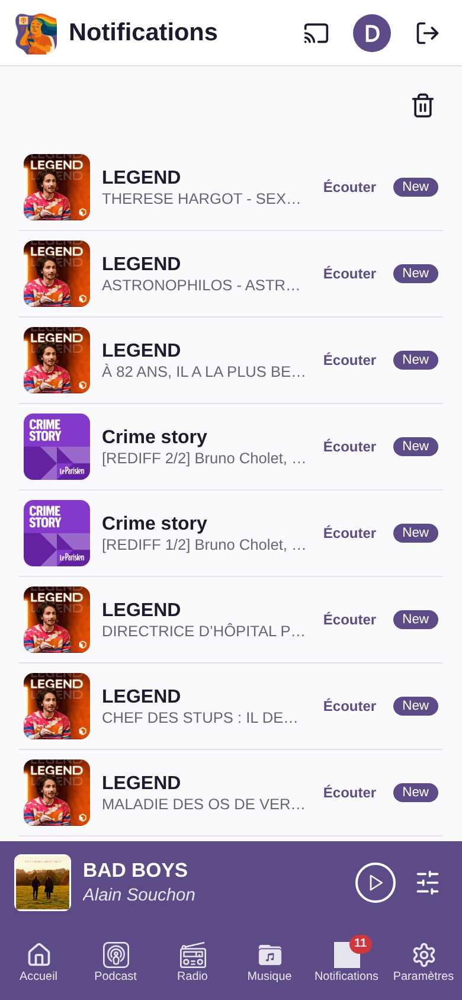

### 3.10 Profil

Modification du nom, de l'email, de la photo (galerie ou appareil photo), des notifications (oui/non), de la tranche d'âge, du pays, des centres d'intérêt, des genres musicaux et de la langue. Le nom, l'email, la tranche d'âge et le pays sont obligatoires. Les changements sont enregistrés automatiquement.

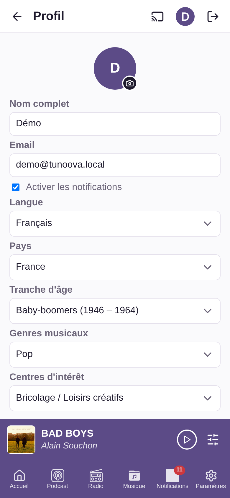

### 3.11 Paramètres

| Réglage | Effet |
|---|---|
| Mode sombre | Thème sombre de l'interface |
| YouTube Music | Active la recherche et la lecture YouTube Music (avertissement à accepter) |
| Qualité du streaming | Automatique, Haute, ou Basse (économie de données) — s'applique à YouTube Music |
| Langue | Français ou anglais |
| Vider le cache local | Efface les données conservées par le navigateur |
| À propos | Version, date de sortie, auteur, licence et lien vers le dépôt |

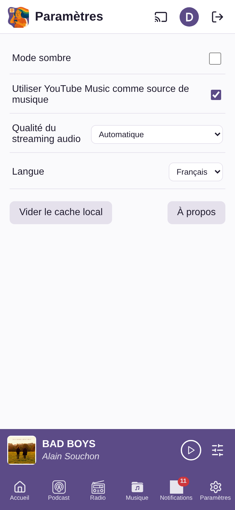

## 4. Espace Admin

L'Espace Admin (`/admin`) est réservé à l'administrateur. Il s'utilise depuis un navigateur d'ordinateur, en français ou en anglais.

| Onglet | Ce qu'on y fait |
|---|---|
| **Tableau de bord** | Vue d'ensemble : utilisateurs actifs, taille de la base, nombre de MP3, d'artistes, de podcasts et de radios, dernier backup, prochain job planifié, mode d'accès réseau. Réglages : serveur SMTP (envoi des emails), dossier et rétention des backups, dossier de la bibliothèque MP3, email et mot de passe admin, purge des journaux. **Mise à jour** de Tunoova en un clic. |
| **Comptes utilisateurs** | Liste triable et filtrable. Création d'un compte (email d'activation envoyé), envoi d'un lien de réinitialisation du mot de passe, activation/désactivation, modification (nom, email, forcer la première connexion, forcer un mot de passe), suppression d'un compte et de toutes ses données. |
| **Base de données** | Consultation et modification directe de toutes les tables : filtres, ajout, modification et suppression de lignes. Sert notamment à gérer les listes de référence (tranches d'âge, centres d'intérêt, genres musicaux, pays, langues). Les mots de passe et clés ne sont jamais affichés. |
| **Jobs planifiés** | Les tâches de fond : activer/désactiver, changer la fréquence (syntaxe cron), voir la dernière exécution et son résultat, lancer immédiatement. |
| **Plug-ins radio** | Les modules qui récupèrent le titre en cours des radios : test, clé d'API, installation d'un nouveau script, retour à la version précédente, suppression. Liste des radios et du plug-in qui leur est associé. |
| **MP3** | Explorateur de la bibliothèque : créer des dossiers, envoyer des MP3 ou des dossiers entiers (glisser-déposer), renommer, déplacer, supprimer, modifier les tags (titre, artiste, album, n° de piste, année), y compris pour tout un dossier. Lancer un scan de la bibliothèque. |
| **Backup** | Liste des sauvegardes (planifiées, avant mise à jour, avant restauration), sauvegarde immédiate, téléchargement d'une archive (base + photos de profil), restauration d'une archive. |
| **Réseau** | Choix du mode d'accès : **Local** (réseau domestique uniquement), **Reverse proxy externe** (votre propre nom de domaine), **VPN privé** Tailscale, ou **Public** via Tailscale Funnel (adresse HTTPS en .ts.net, sans ouvrir de port sur la box). Affiche l'adresse de l'appli et un QR code. |

#### Tableau de bord

#### Comptes utilisateurs

#### Base de données

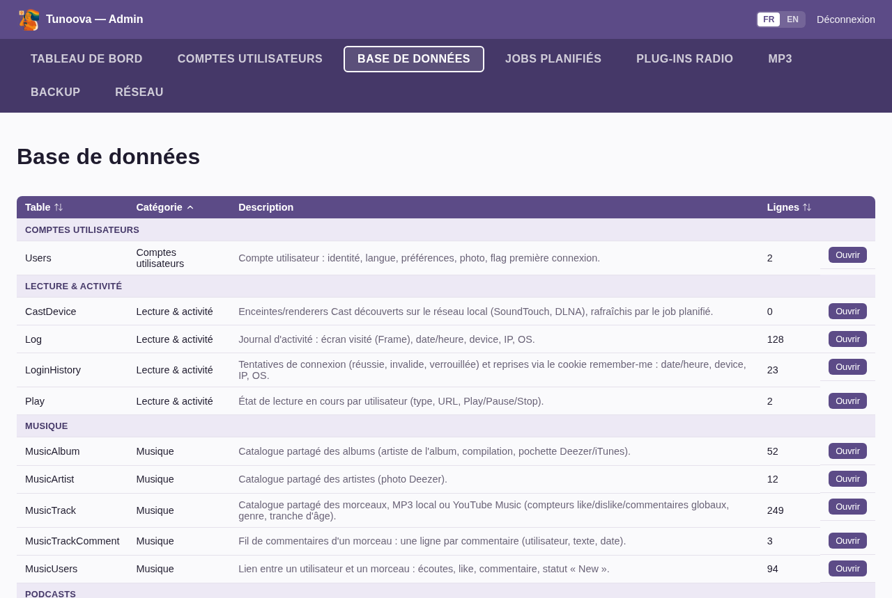

#### Jobs planifiés

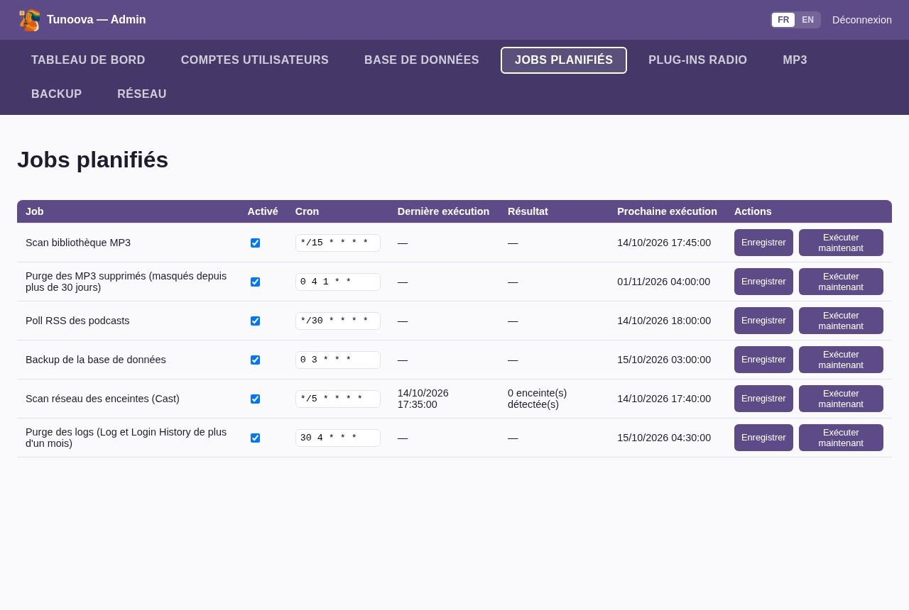

#### Plug-ins radio

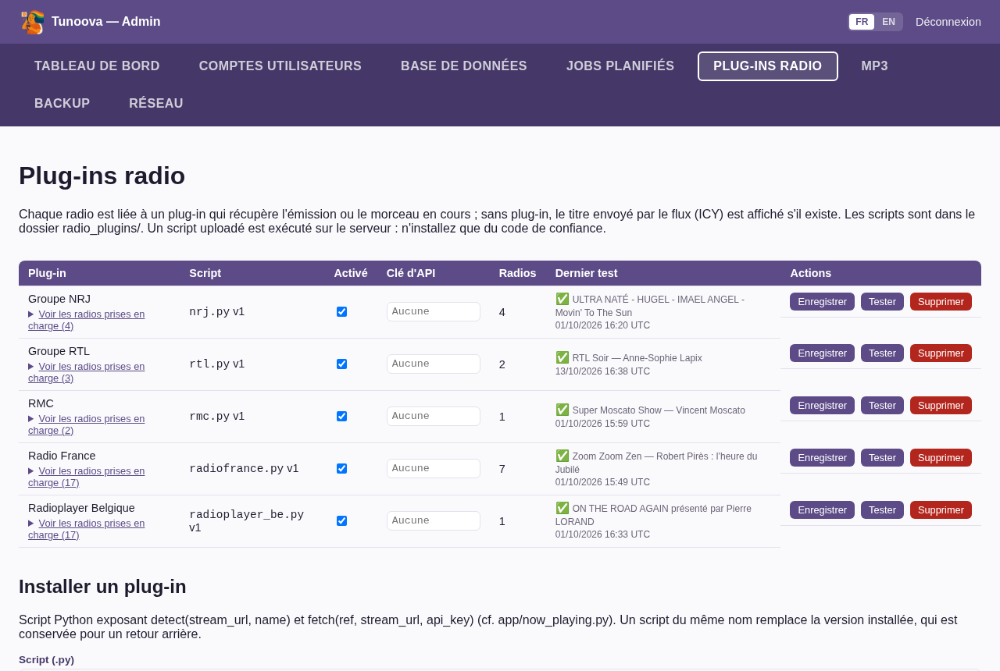

#### MP3

#### Backup

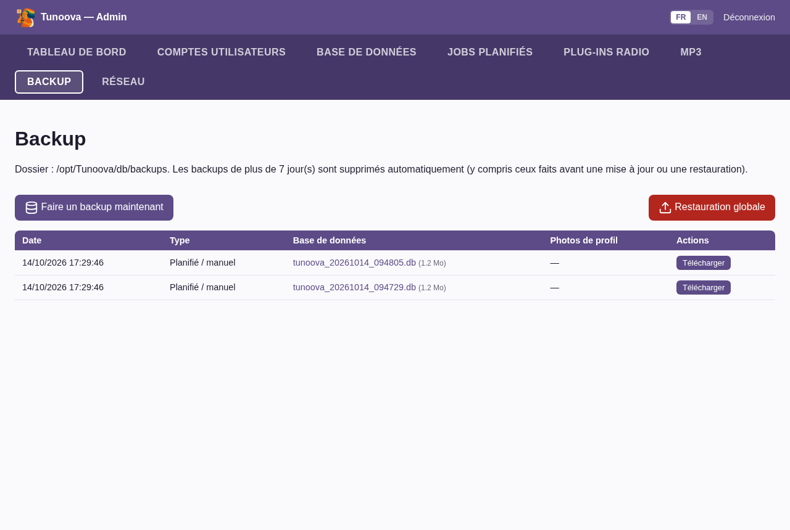

#### Réseau

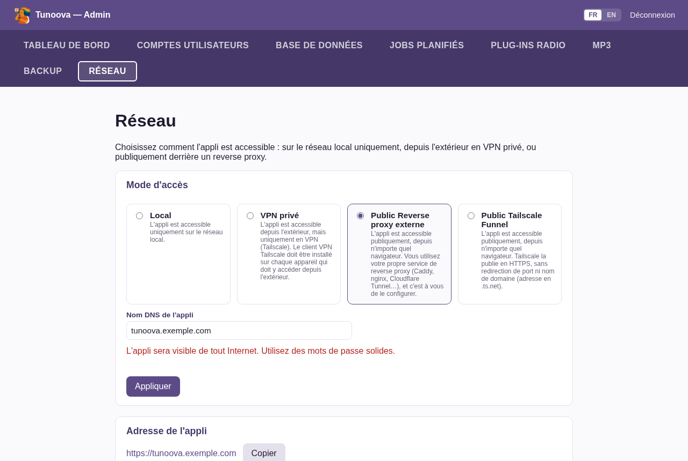

### Tâches automatiques

| Tâche | Fréquence par défaut | Rôle |
|---|---|---|
| Scan bibliothèque MP3 | toutes les 15 min | Ajoute les nouveaux MP3, relit les tags modifiés, masque les fichiers supprimés, cherche pochettes et photos d'artistes |
| Purge des MP3 supprimés | le 1er du mois à 4h | Supprime définitivement les morceaux masqués depuis plus de 30 jours |
| Poll RSS des podcasts | toutes les 30 min | Récupère les nouveaux épisodes |
| Backup de la base | chaque jour à 3h | Sauvegarde la base et les photos de profil |
| Scan des enceintes | toutes les 5 min | Recherche les enceintes du réseau local |
| Purge des journaux | chaque jour à 4h30 | Supprime les journaux de plus d'un mois |

## 5. Données personnelles

L'appli enregistre, pour chaque utilisateur : son profil, ses abonnements et favoris, ses écoutes, ses votes, ses commentaires, l'état de sa lecture, et un journal des écrans visités et des connexions (date, adresse IP, appareil, système). Ces journaux sont supprimés au bout d'un mois. Toutes les données restent sur le serveur de l'administrateur. Le détail figure dans la Politique de confidentialité de l'appli.

## 6. Limites connues

- Interface en français et en anglais uniquement.
- Pas d'application mobile native : l'appli s'utilise dans le navigateur du téléphone. Une version Android (Android Auto) est prévue en V2.
- La diffusion Cast ne fonctionne qu'en réseau local.
- La lecture YouTube Music dépend d'outils tiers qui peuvent cesser de fonctionner après un changement chez YouTube, jusqu'à la mise à jour suivante.
- Prévu pour une version ultérieure : détection des nouveaux albums sur YouTube Music, multiroom, filtrage des publicités radio, suggestions personnalisées.
