# Tunoova

🇬🇧 **English** · 🇫🇷 [Français](README.fr.md)

> ### 🚀 [Install Tunoova →](Doc/Installation.md)
> One-command install on Debian / Ubuntu / Raspberry Pi OS, first-time setup and quick start.

| Documentation | Content |
| --- | --- |
| **[Installation](Doc/Installation.md)** | Install, first-time setup, updates, useful commands |
| [Technical documentation](<Doc/Technical documentation.md>) | Architecture, `.env` configuration, database, security |
| [Database structure](<Doc/DB Structure.md>) | Every table and column |
| [Radio plug-ins](<Doc/Plugins radio/README.md>) | Writing a radio plug-in (in French) |
| [Security audit](<Doc/Audit Tunoova.md>) | Running an audit and handling its results (in French) |
| [License](Doc/Licence/LICENSE.md) | PolyForm Noncommercial 1.0.0 |

This document walks through the app screen by screen, from the user's point of view.

## 1. What is Tunoova?

Tunoova (*Tune* + *nova*) is a self-hosted web app that brings together in one place:

- your **podcasts** (RSS feed subscriptions);
- your live **radio stations**;
- your **music**: the MP3s stored on the server and, if you turn it on, YouTube Music.

It runs on a Raspberry Pi, a PC on your home network or a VPS. You use it from a browser, on a computer or a phone; its interface is designed mobile-first. It is meant for a family or a small group of friends: everyone has their own account, subscriptions and preferences, and can share what they listen to with the others.

What the app gives you:

- **One player** for everything you listen to. Playback keeps going while you browse the app.
- **Resume on another device**: the current playback is saved on the server. You pick it up at the same spot on your phone or your computer.
- **No ads and no commercial suggestions.** Nothing is sent to a third-party service to profile you.
- **Your MP3 library available everywhere**, with album covers and artist photos found automatically.
- **Playback on your speakers** on the local network (Bose SoundTouch, DLNA speakers).
- **Sharing** between users: share a track, a radio station or an episode, like, comment.

## 2. Roles

| Role              | Who                                 | Access                                                                                                                                  |
| ----------------- | ----------------------------------- | --------------------------------------------------------------------------------------------------------------------------------------- |
| **User**          | A family member or an invited friend | The app: `/`                                                                                                                            |
| **Administrator** | The person who hosts the app        | The Admin area: `/admin`. This account is separate from user accounts: to listen, the administrator also creates a user account for themselves. |

Sign-up is **closed**. A visitor can only **request** an account; the administrator creates it.

## 3. User journey

### 3.1 Getting an account and signing in

1. On the sign-in screen, the visitor clicks **Create an account** and enters their name and email. The administrator receives the request by email.
2. The administrator creates the account from the Admin area. The user receives an email with an **activation link valid for 24 hours**, to choose their password.
3. The user signs in with their email and password. The app remembers the session on that device for 30 days (extended on each visit): no need to type the password again.
4. On **first sign-in**, the **Your Profile** screen asks for: name, photo, age range, country, hobbies, music genres and language (French or English).
5. Once the profile is saved, the user already finds a **welcome pack** of a few radio stations and podcasts in their lists, picked by language: BBC World Service, Classic FM, KEXP, Jazz24, Radio Paradise and three English podcasts for an English speaker; France Inter, franceinfo, FIP, RTL, Nostalgie and three French podcasts for a French speaker. They can delete them like any other item; the pack is offered only once. The administrator edits these lists in `app/starter_content.json`.

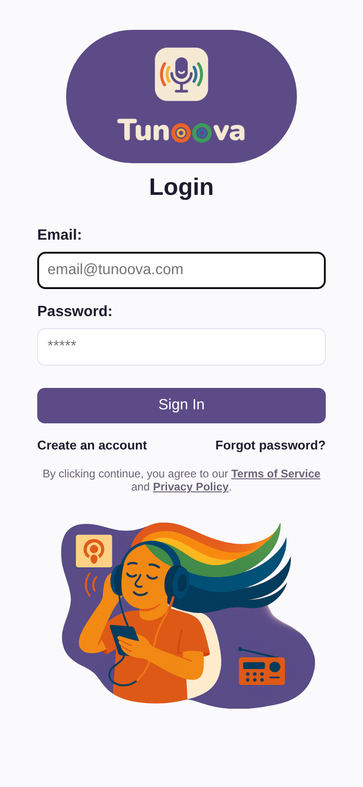

**Forgot password?**: the link on the sign-in screen sends a request to the administrator, who triggers a reset link (valid for 1 hour, single use).

**Password rule**: at least 8 characters, with at least one uppercase letter, one lowercase letter, one digit and one special character.

**Protection**: after 5 failed sign-in attempts, the account is locked for 15 minutes to prevent brute-force attacks. Attempts are also counted per IP address.

The **Terms of Service** and the **Privacy Policy** are available from the sign-in screen. The app itself is distributed under the PolyForm Noncommercial 1.0.0 license (non-commercial use only).

**Install the app on your device (recommended)**: for the best experience, install Tunoova from **Chrome** as an app. It then opens in its own window, without an address bar or tabs, with its icon in the Start menu, the Dock or the home screen.

- **Computer (Chrome)**: when the app is opened through its `https://` address (remote access via Tailscale or a reverse proxy, see Admin area > Network), click the **Install** icon on the right of the address bar. Otherwise, for example on `http://<ip>:5000` on the local network: menu **⋮ > Cast, save, and share > Install page as app…**, then **Install**.
- **Android (Chrome)**: menu **⋮ > Add to Home screen**, then **Install**.
- **iPhone / iPad (Safari)**: **Share > Add to Home Screen**.

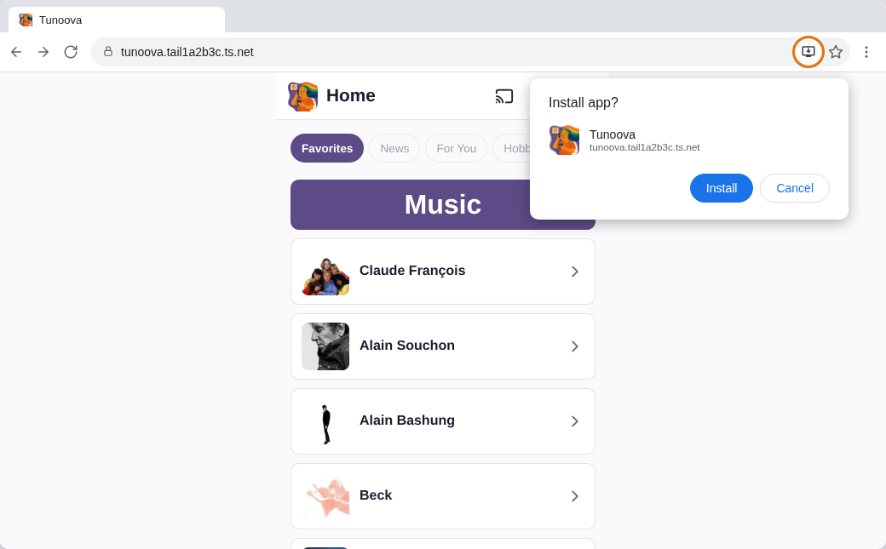

### 3.2 The interface

Every screen has:

- **at the top**: the Back button, the **Cast** button, the profile photo (opens the profile) and sign-out;
- **at the bottom**: the **mini-player** (what is playing now, play/pause button) and the navigation bar: Home · Podcast · Radio · Music · Notifications · Settings. A badge on Notifications shows the number of new items.

Clicking the mini-player opens the **Now Playing** screen.

> The screenshots in this document were taken with a demo account, in phone format.

### 3.3 Home

Home (**Favorites** tab) shows what you listen to most:

| Section | Content |
|---|---|
| Podcasts | Your 5 most-listened podcasts |
| Radios | Your 5 most-listened radio stations |
| Music | The artists of your 10 most-played tracks (one tile per artist) |

The **Section order** button lets you choose the order of the three sections (for example, Music first). The choice is remembered.

The *News*, *For You* and *Hobby* tabs are visible but not active yet.

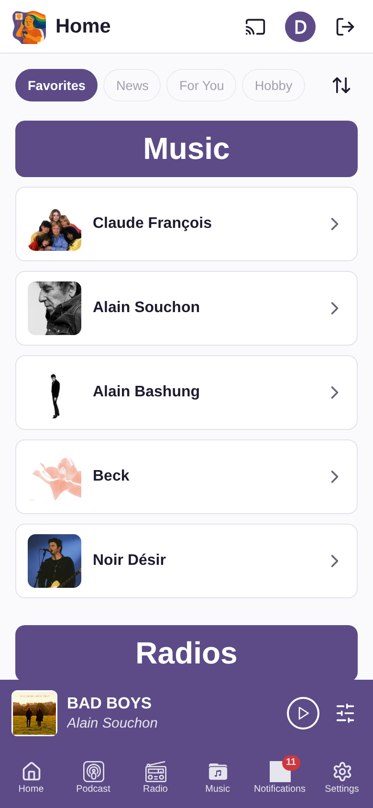

### 3.4 Podcasts

- **List**: your podcasts as tiles, sortable (newest, oldest, A→Z, Z→A). The chosen sort is remembered.
- **Search**: from 3 characters, the app searches both **your podcasts** (podcast name or episode title) and **the Internet** (Apple Podcasts catalog). Clicking **Add** subscribes to the podcast found.
- **Advanced**: add a podcast manually with its title, RSS feed URL and image URL.
- **Podcast details**: the list of episodes (20 per page, more load as you scroll), a button to **refresh** the episodes, and an **Edit** button.
- **Edit**: title, RSS feed, image and episode **Filter**:
  - `max:20` shows only the first 20 episodes;
  - `contain:INTEGRALE` keeps only the titles containing INTEGRALE;
  - `exclude:LIVE` removes the titles containing LIVE.

  The **Delete** button removes the podcast from your list (after confirmation).
- **New episodes** are fetched automatically every 30 minutes and show up in Notifications. Episodes that already exist when you add a podcast are not flagged as new.
- Multi-part series ("[1/2]", "[2/2]") are shown and chained in playing order.

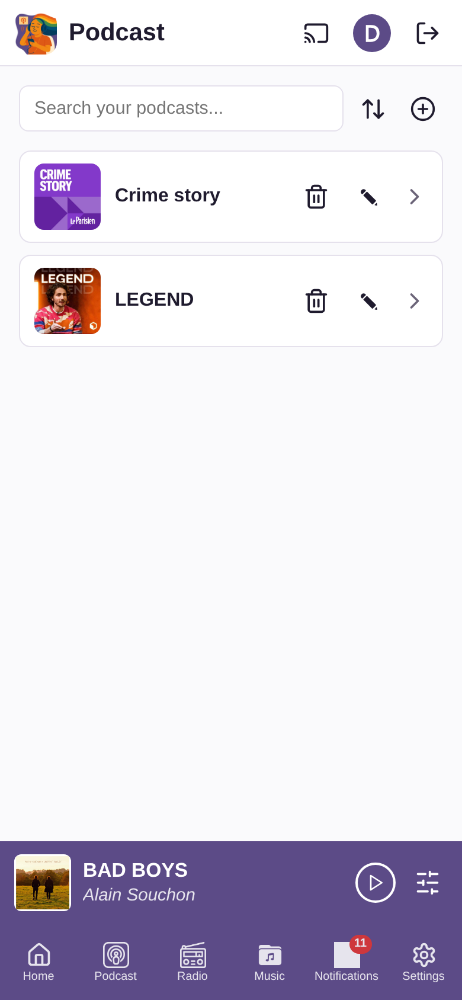 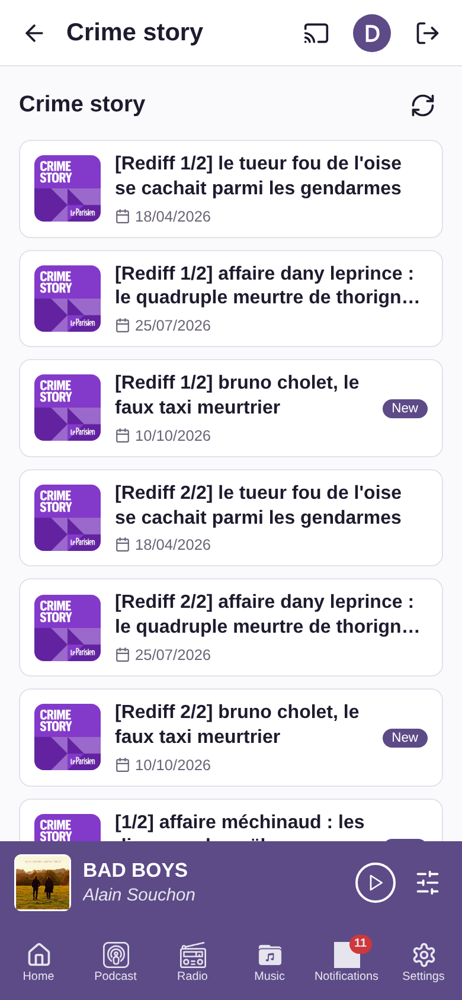

### 3.5 Radios

- **List**: your favorite radio stations, sortable (recently played, A→Z, Z→A).
- **Search**: from 3 characters, the app searches your stations and the worldwide **Radio Browser** directory. Stations from your profile's country come first. Clicking a result **adds the station to your favorites and starts playing it**.
- **Advanced**: add a station manually (title, stream URL, image URL).
- **Edit / Delete** a station from your list.
- **Now on air**: while you listen, the app shows the current show or track when possible. This information comes from plug-ins (Radio France, RTL group, RMC, NRJ group and Belgian stations are included); the administrator can add plug-ins for other stations. Without a plug-in, the app shows the title sent by the stream itself, when there is one.

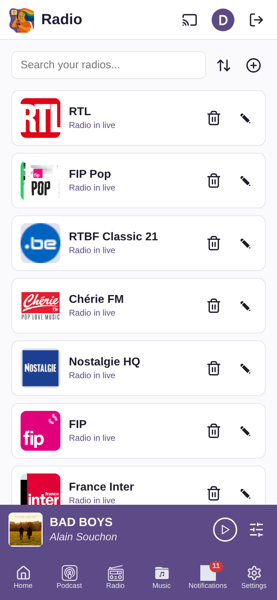

### 3.6 Music

The Music screen shows the library shared by all users: the server's MP3s and the YouTube Music tracks users have added.

To get all the Music features (YouTube search, "Most Popular", "Other albums"), turn on the YouTube Music option in Settings. You must then comply with the YouTube Music terms of use.

- **Sorting**: by **Artist**, by **Album**, or **My Favorite Music** (only what you have already played), each A→Z or Z→A. The sort is remembered.
- **Browsing**: Artist → their albums → an album's tracks. Clicking an album or an artist can start playback directly.
- **Most Popular**: an artist's most-played tracks on YouTube Music.
- **Other albums**: the artist's albums available on YouTube Music and missing from the library. They can be imported.
- **Search**: from 3 characters, the app searches the server's MP3s (title, artist, album), then YouTube Music if you turned it on. It goes straight to the most precise level: the album if the search targets an album, the artist if it targets an artist.
- Tracks from YouTube Music carry a YouTube badge.

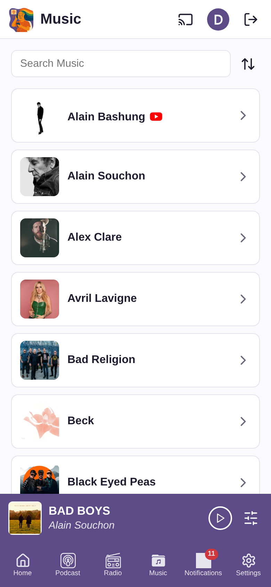 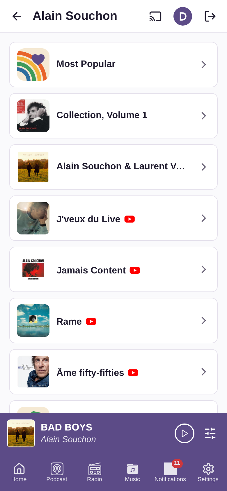 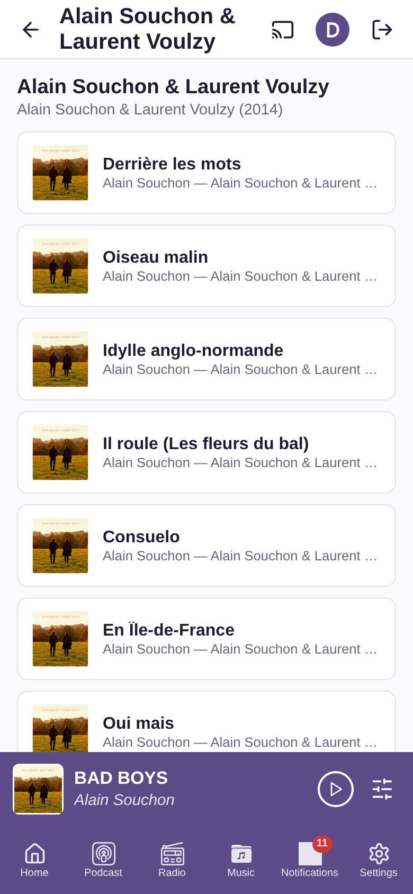

### 3.7 Now Playing

The Now Playing screen shows the large image of the content, its title and:

- the progress bar (seek), the **Previous / Play-Pause / Next** buttons (except for a live radio);
- **Like / Dislike**, with the total number of votes from all users;
- the **play count** (all users);
- **Comments**: one shared thread per track, per radio station or per podcast. Everyone can post several comments and delete their own;
- **Share**: send to one or more other users, who receive it in their Notifications.

Playback behavior:

- Playback **does not stop** when you change screens.
- At the end of a track or an episode, the **next one follows** (album order, artist order or "Most Popular" list). On a phone, the next track is downloaded in advance so that chaining also works with the screen locked.
- Playback controls appear on the phone's **lock screen**.
- When you come back to the app, or on another device, playback resumes where it stopped.

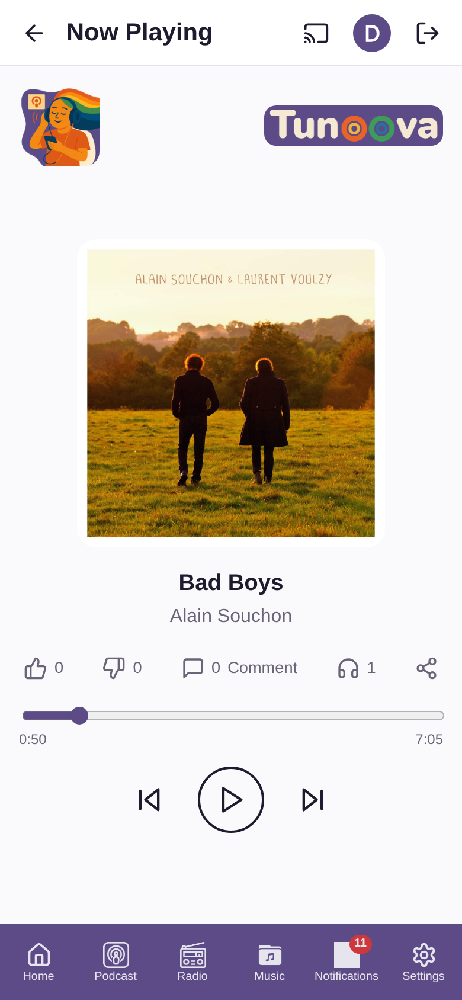

### 3.8 Playing on a speaker (Cast)

The **Cast** button lists the speakers found on the local network (Bose SoundTouch and DLNA devices), with their status (online, playing).

- Choosing a speaker sends the current content to it, **at the same position**.
- You can switch from one speaker to another, set the speaker **volume**, pause, or stop casting to go back to playback on the device.
- Track chaining continues on the speaker.
- Speakers are discovered automatically every 5 minutes.

Casting only works when the server and the speaker are on the same local network.

### 3.9 Notifications

The Notifications screen groups, newest first:

| Type | When |
|---|---|
| New episode | A podcast you subscribe to publishes an episode |
| New MP3s | MP3s by an artist you have already played are added to the server (grouped by album) |
| Share | Another user shared a track, a radio station or an episode with you |
| New version | The administrator detected a Tunoova update to install |

Each notification lets you play the content directly, or open the album. A shared radio station only joins your list if you listen to it. **Clear all** marks all notifications as read (and declines the shared stations you have not played). The new-version notification stays until the update is installed.

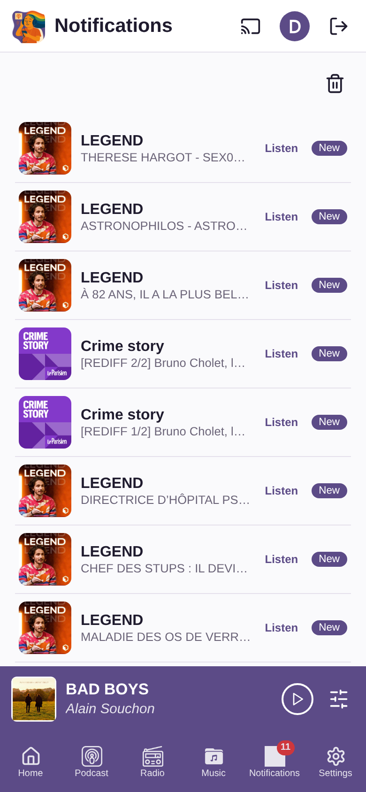

### 3.10 Profile

Edit your name, email, photo (gallery or camera), notifications (on/off), age range, country, hobbies, music genres and language. Name, email, age range and country are required. Changes are saved automatically.

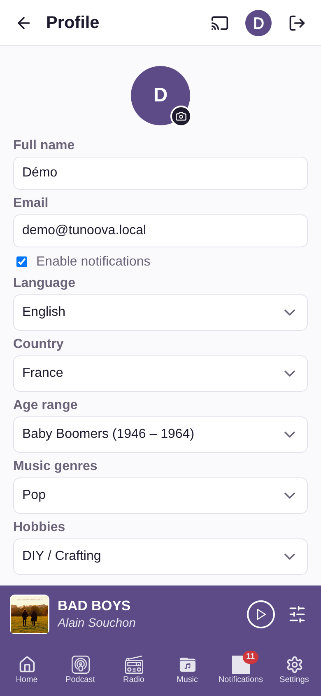

### 3.11 Settings

| Setting | Effect |
|---|---|
| Dark mode | Dark theme for the interface |
| YouTube Music | Turns on YouTube Music search and playback (a warning must be accepted) |
| Audio streaming quality | Automatic, High, or Low (data saver) — applies to YouTube Music |
| Language | French or English |
| Clear local cache | Erases the data kept by the browser |
| About | Version, release date, author, license and link to the repository |

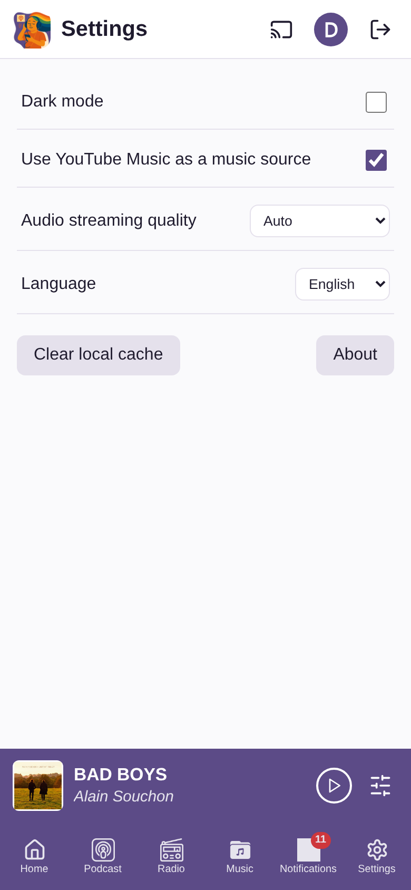

## 4. Admin area

The Admin area (`/admin`) is reserved for the administrator. It is used from a computer browser, in French or English.

| Tab | What you do there |
|---|---|
| **Dashboard** | Overview: active users, database size, number of MP3s, artists, podcasts and radio stations, last backup, next scheduled job, network access mode. Settings: SMTP server (sending emails), backup folder and retention, MP3 library folder, admin email and password, log purge. One-click Tunoova **Update**. |
| **User accounts** | Sortable, filterable list. Create an account (activation email sent), send a password reset link, activate/deactivate, edit (name, email, force first login, force a password), delete an account and all its data. |
| **Database** | View and edit every table directly: filters, add, edit and delete rows. Used in particular to manage the reference lists (age ranges, hobbies, music genres, countries, languages). Passwords and keys are never displayed. |
| **Scheduled jobs** | Background tasks: enable/disable, change the frequency (cron syntax), see the last run and its result, run now. |
| **Radio plug-ins** | The modules that fetch what is on air: test, API key, install a new script, roll back to the previous version, delete. List of stations and the plug-in attached to each one. |
| **MP3** | Library explorer: create folders, upload MP3s or whole folders (drag and drop), rename, move, delete, edit tags (title, artist, album, track number, year), including for a whole folder. Run a library scan. |
| **Backup** | List of backups (scheduled, before update, before restore), back up now, download an archive (database + profile photos), restore an archive. |
| **Network** | Choose the access mode: **Local** (home network only), **External reverse proxy** (your own domain name), Tailscale **Private VPN**, or **Public** through Tailscale Funnel (HTTPS address on .ts.net, without opening a port on your router). Shows the app address and a QR code. |

#### Dashboard

#### User accounts

#### Database

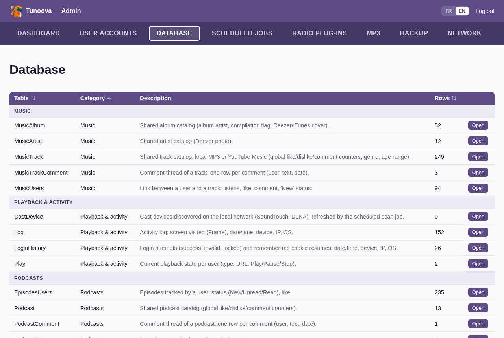

#### Scheduled jobs

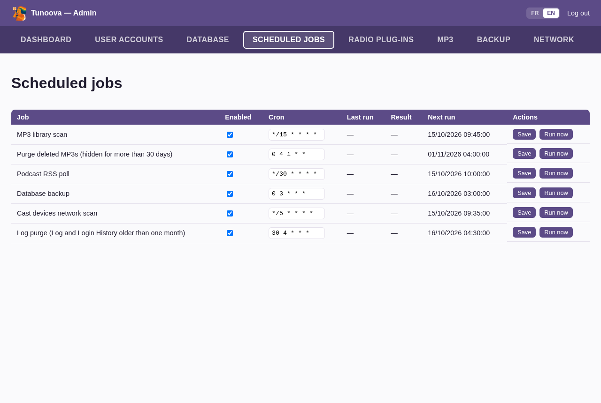

#### Radio plug-ins

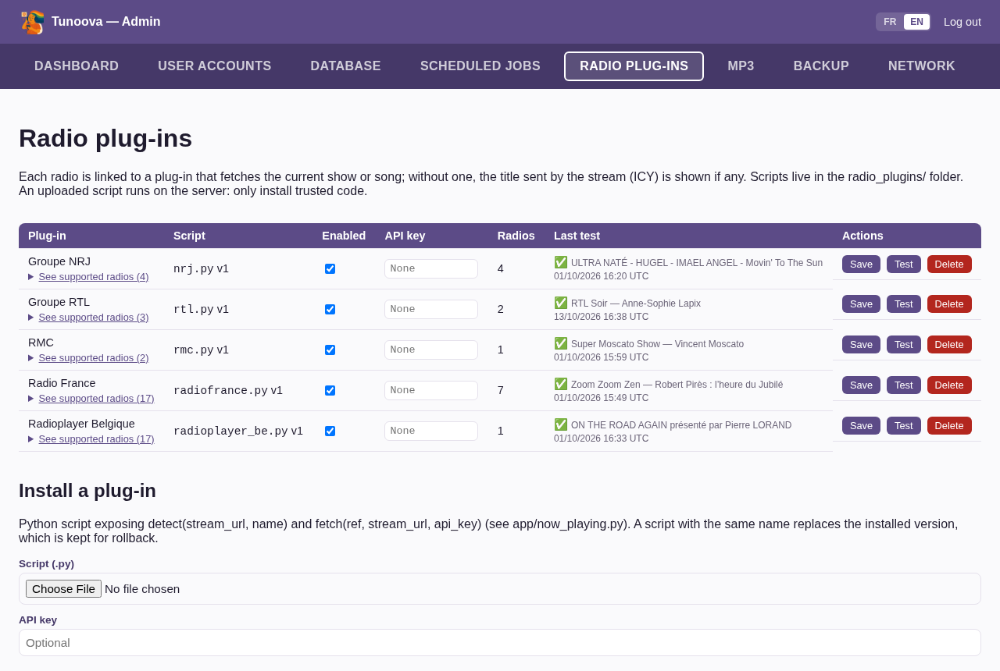

#### MP3

#### Backup

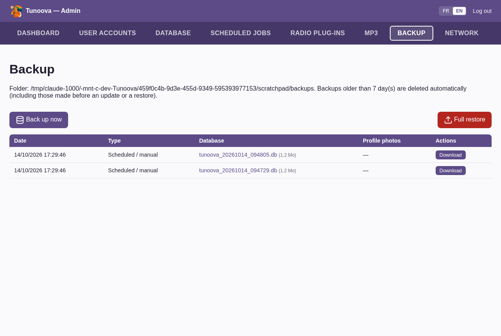

#### Network

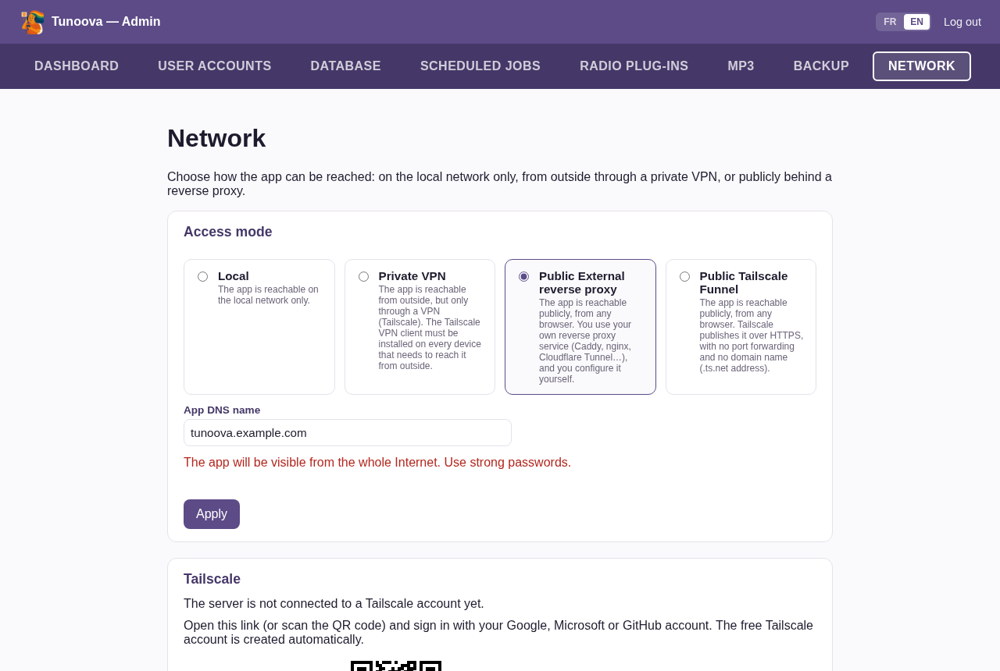

### Automatic tasks

| Task | Default frequency | Purpose |
|---|---|---|
| MP3 library scan | every 15 min | Adds new MP3s, re-reads changed tags, hides deleted files, looks for covers and artist photos |
| Purge of deleted MP3s | 1st of the month at 4 am | Permanently removes tracks hidden for more than 30 days |
| Podcast RSS poll | every 30 min | Fetches new episodes |
| Database backup | every day at 3 am | Backs up the database and profile photos |
| Speaker scan | every 5 min | Looks for speakers on the local network |
| Log purge | every day at 4:30 am | Deletes logs older than one month |

## 5. Personal data

For each user, the app stores: their profile, subscriptions and favorites, plays, votes, comments, playback state, and a log of visited screens and sign-ins (date, IP address, device, system). These logs are deleted after one month. All data stays on the administrator's server. Details are in the app's Privacy Policy.

## 6. Known limitations

- Interface in French and English only.
- No native mobile app: the app runs in the phone's browser. An Android version (Android Auto) is planned for V2.
- Casting only works on the local network.
- YouTube Music playback relies on third-party tools that may stop working after a change at YouTube, until the next update.
- Planned for a later version: detection of new albums on YouTube Music, multiroom, radio ad filtering, personalized suggestions.
